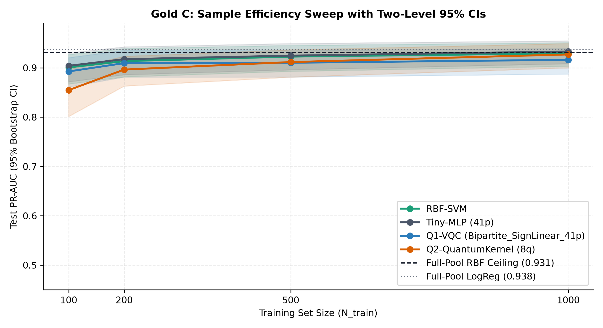
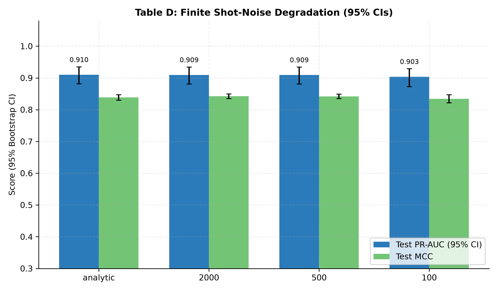
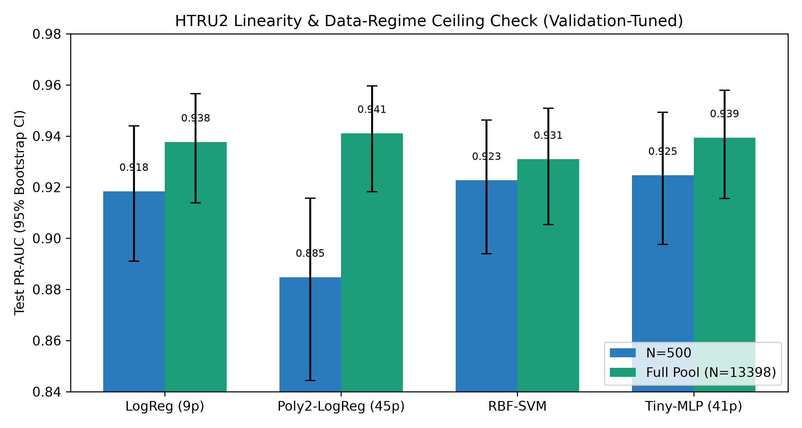

<div align="center">

<samp>Q // HORIZON 2026 &nbsp;·&nbsp; QUANTUM MACHINE LEARNING BENCHMARK</samp>

# Pulsar Signal Classification<br><sub>Variational Circuits & Quantum Kernels vs. Classical Baselines</sub>

<p>
  <a href="https://zeyadmsn07.github.io/qhorizon-2026/"><kbd>&nbsp;Interactive Landing Page ↗&nbsp;</kbd></a>
  &nbsp;&nbsp;
  <a href="Q_Horizon_Benchmark.ipynb"><kbd>&nbsp;Benchmark Notebook&nbsp;</kbd></a>
  &nbsp;&nbsp;
  <a href="results/full/summary_tables.md"><kbd>&nbsp;Full 10-Seed Tables&nbsp;</kbd></a>
  &nbsp;&nbsp;
  <a href="AI_USAGE_LOG.md"><kbd>&nbsp;AI Usage Log&nbsp;</kbd></a>
</p>

<sub><b>Dataset:</b> UCI HTRU2 (17,898 candidates, 9.16% pulsars) &nbsp;&middot;&nbsp; <b>Circuit Size:</b> Up to 8 qubits &nbsp;&middot;&nbsp; <b>Protocol:</b> 3 tune seeds / 10 test seeds &nbsp;&middot;&nbsp; <b>Stack:</b> PennyLane, PyTorch, scikit-learn</sub>

</div>

<br>

---

## Why Radio Pulsars on Eight Qubits

Finding pulsars in modern radio-telescope surveys means separating rare, periodic neutron-star signals from heavy radio-frequency interference and background noise. We built this study around the **UCI HTRU2 Pulsar Candidate Dataset** (R. J. Lyon et al., 2016, ID `372`), which records 17,898 candidate detections from the High Time Resolution Universe Survey. Each candidate is represented by 8 continuous measurements: four from the folded pulse profile (mean, standard deviation, kurtosis, and skewness) and four from the dispersion-measure signal-to-noise (DM-SNR) curve.

We chose HTRU2 for three reasons:

1. Its 8 physical measurements map one-to-one onto an 8-qubit circuit without PCA or dropped features, staying comfortably inside near-term ($\le 10$ qubit) simulation limits while letting us wire the 4 pulse-profile qubits directly to the 4 DM-SNR qubits.
2. Real pulsars make up only 9.16% of the survey and several features have extreme outlier tails. A trivial classifier that predicts noise every time scores 90.83% accuracy while missing every pulsar, forcing a realistic pipeline built around train-only power scaling and Precision-Recall AUC (PR-AUC).
3. Clean physics summaries give classical algorithms a strong home-turf advantage, making HTRU2 an honest test of compact quantum circuits rather than a cherry-picked showcase. To separate dataset geometry from model capacity, we pair HTRU2 with a controlled 8-dimensional nonlinear task (`ConcentricShell-8D`).

---

## Explore & Run the Project

To make our results intuitive and easy to explore without digging through raw CSV files, we built an interactive landing page where you can switch between datasets, hover over 10-seed confidence intervals, and inspect each experiment step by step. You can explore the results and run the full benchmark either online or offline.

<table>
<tr>
<td width="50%" valign="top">

### <samp>01 // ONLINE</samp><br>Browser & Google Colab

Open the hosted landing page in any browser with zero installation:

<p align="center">
  <a href="https://zeyadmsn07.github.io/qhorizon-2026/"><b>https://zeyadmsn07.github.io/qhorizon-2026/</b></a>
</p>

To run the code in the cloud, open `Q_Horizon_Benchmark.ipynb` (or `Q_Horizon_Dashboard.ipynb`) in Google Colab directly from this repository, run `pip install -r requirements.txt` in the first cell, and execute the notebook from top to bottom.

</td>
<td width="50%" valign="top">

### <samp>02 // OFFLINE</samp><br>Local HTML & CLI Suite

Because HTRU2 is cached locally in `data_cache/htru2.csv`, everything runs offline after cloning or downloading the ZIP.

Double-click `dashboard/qhorizon_dashboard.html` to open the interactive page in Chrome, Edge, Firefox, or Safari (or run `python dashboard/serve.py` after regenerating results). To run the automated test suite or reproduce the experiments locally, use the terminal commands below.

</td>
</tr>
</table>

```bash
# Install dependencies
pip install -r requirements.txt

# Run all 14 unit tests and submission checks (~5 sec)
python scripts/check_submission.py

# Quick end-to-end verification across every pipeline (~7.5 min -> results/smoke/)
python run_all.py --mode smoke

# Medium 3-seed pass (~12.5 min -> results/fast/)
python run_all.py --mode fast

# Full 10-seed benchmark from scratch (writes to results/full/)
python run_all.py --mode full --tune-seeds 3
python analyze_results.py --results-dir results/full
python -m src.plot_results --results-dir results/full
```

---

## Key Findings at a Glance

> [!IMPORTANT]
> Every tunable model shares an identical 20-configuration search budget on 3 disjoint validation seeds (`200..202`) before being scored across 10 independent evaluation seeds (`100..109`). Thresholds and Yeo-Johnson feature transforms never touch the locked 3,000-sample test split.

* Classical models lead on HTRU2 because the feature space is already nearly linear. At $N = 500$ training samples, our 41-weight `Tiny-MLP` scores `0.9246` PR-AUC and `RBF-SVM` scores `0.9227`, ahead of the 8-qubit `Q2-QuantumKernel` (`0.9116`) and the 41-weight `Q1-VQC` (`0.9102`). Against `RandomForest` (`0.9016`), only `Q2-QuantumKernel` clears our $\pm 0.01$ practical margin (`+0.0101`), whereas `Q1-VQC` (`+0.0086`) lands inside the practical-tie band. On the full 13,398-sample training pool, a 9-weight linear `LogReg` reaches `0.9377` PR-AUC, virtually matching `Tiny-MLP` (`0.9394`).
* Multi-seed validation tuning and a joint circuit redesign stabilized VQC training. In our initial single-seed-tuned baseline, the ring-entangled circuit (`Ring L=2`) collapsed below `0.70` PR-AUC on 2 of 10 seeds (`0.7800`). Moving to 3-seed validation tuning eliminated all collapses on `Ring L=2` (`0.8860`, `0/10` collapses). Adding a $\pi/2$ phase shift alone (`0.8854`) or an 8-qubit linear readout alone (`0.8869`) made no standalone difference, whereas combining sparse bipartite wiring (8 CNOTs instead of 16; depth 7 instead of 21) with the $\pi/2$ shift and 8-qubit linear readout lifted PR-AUC to `0.9102`.
* On our synthetic 8D inner-ball task (`ConcentricShell-8D`), linear `LogReg` fails (`0.1165`), while `Q2-QuantumKernel` (`0.8832`) and `RBF-SVM` (`0.8695`) finish in a statistical tie with overlapping 95% confidence intervals. At $N = 500$, the 41-weight `Q1-VQC` (`0.6602`) beats the 4-neuron `Tiny-MLP` (`0.4075`) after struggling at $N = 100$ (`0.1307`) and $N = 200$ (`0.3127`). Width sweeps confirm this gap comes from two design factors: the synthetic label is even in every coordinate ($f(-x) = f(x)$), matching $\cos(\cdot)$ qubit rotations, and 4 hidden neurons bottleneck radial closure. Widening `Tiny-MLP` to 8, 16, and 32 neurons raises PR-AUC to `0.5936`, `0.6195`, and `0.7767`, overtaking `Q1-VQC`.

---

## 1. Fair Benchmark — Pulsar Classification at $N = 500$

* `Q1-VQC (Bipartite_SignLinear_41p)` and `Tiny-MLP (41p)` both train 41 scalar weights with minibatch AdamW and binary cross-entropy early stopping, backed by MLP width checks (`21p` to `321p`) so parameter matching never hides a width bottleneck.
* `Q2-QuantumKernel (8q)` and `RBF-SVM` use the exact same dual Support Vector Machine solver with zero gradient-trained weights; only the kernel matrix differs.
* Yeo-Johnson scaling is fit strictly on `X_train` per seed, and decision thresholds are chosen on the 1,500-sample validation set before evaluating once on the 3,000-sample test set.

<p align="center">
  
</p>

| Model | PR-AUC (Mean $\pm$ Std) | Collapse | Test F1 | Test MCC | Test Acc | Weights | Tuned HP | SVs | CPU s\* |
| :--- | :---: | :---: | :---: | :---: | :---: | :---: | :---: | :---: | :---: |
| Dummy | $0.0917 \pm 0.0000$ | 10/10 | $0.0000 \pm 0.0000$ | $0.0000 \pm 0.0000$ | $0.9083 \pm 0.0000$ | 0 | 0 | -- | 0.00 |
| LogReg | $0.9184 \pm 0.0169$ | 0/10 | $0.8737 \pm 0.0102$ | $0.8619 \pm 0.0116$ | $0.9773 \pm 0.0023$ | 9 | 2 | -- | 0.01 |
| RBF-SVM | $0.9227 \pm 0.0036$ | 0/10 | $0.8702 \pm 0.0081$ | $0.8579 \pm 0.0091$ | $0.9766 \pm 0.0018$ | 0 | 3 | 64.9 | 0.01 |
| RandomForest | $0.9016 \pm 0.0089$ | 0/10 | $0.8494 \pm 0.0112$ | $0.8358 \pm 0.0140$ | $0.9730 \pm 0.0030$ | 0 | 4 | -- | 0.04 |
| **Tiny-MLP (41p)** | **$0.9246 \pm 0.0079$** | **0/10** | **$0.8753 \pm 0.0129$** | **$0.8632 \pm 0.0146$** | **$0.9774 \pm 0.0028$** | **41** | **4** | **--** | **0.32** |
| Q1-VQC (Bipartite_SignLinear_41p) | $0.9102 \pm 0.0025$ | 0/10 | $0.8524 \pm 0.0077$ | $0.8384 \pm 0.0084$ | $0.9735 \pm 0.0017$ | 41 | 4 | -- | 11.36 |
| Q1-VQC (Ring L=2, Fragile v1) | $0.8860 \pm 0.0062$ | 0/10 | $0.8373 \pm 0.0085$ | $0.8223 \pm 0.0086$ | $0.9712 \pm 0.0012$ | 34 | 4 | -- | 17.97 |
| Q2-QuantumKernel (8q) | $0.9116 \pm 0.0057$ | 0/10 | $0.8508 \pm 0.0049$ | $0.8360 \pm 0.0055$ | $0.9729 \pm 0.0011$ | 0 | 4 | 55.1 | 0.27 |

<sub>*Quantum CPU times reflect PennyLane <code>default.qubit</code> statevector simulation rather than physical QPU hardware. Medians, IQRs, and HTRU2 MLP capacity checks (<code>21p</code> = <code>0.9270</code>, <code>41p</code> = <code>0.9246</code>, <code>81p</code> = <code>0.9246</code>) are archived in <a href="results/full/summary_tables.md"><code>results/full/summary_tables.md</code></a>.</sub>

---

## 2. Statistical Audit (Mechanical Verdict Ledger)

Every hypothesis is scored automatically by `analyze_results.py` using a **Mechanical Verdict** rule built on a $\pm 0.01$ PR-AUC practical margin and a 95% two-level bootstrap confidence interval (jointly resampling the 10 seeds and the 3,000 stratified test examples):

* <samp>Supported</samp> — the entire 95% CI lies above `0` and the mean gain exceeds `0.01` PR-AUC.
* <samp>Practically tied</samp> — the entire 95% CI sits inside `[-0.01, +0.01]`.
* <samp>Contradicted</samp> — the entire 95% CI lies below `0` with a drop beyond `0.01` PR-AUC (or outside the tie band for tie tests).
* <samp>Inconclusive</samp> — the 95% CI touches `0` or crosses the $\pm 0.01$ margin boundary.

| ID | Comparison (Model A vs. Model B) | $\Delta$ PR-AUC | 95% Two-Level CI | Wilcoxon $p$ | Verdict |
| :--- | :--- | :---: | :---: | :---: | :---: |
| `H1a` | Tiny-MLP (41p) vs. Q2-QuantumKernel (8q) | `+0.0130` | `[+0.0047, +0.0217]` | 0.0039 | <samp>Supported</samp> |
| `H1b` | Tiny-MLP (41p) vs. Q1-VQC (Bipartite_SignLinear_41p) | `+0.0144` | `[+0.0060, +0.0232]` | 0.0020 | <samp>Supported</samp> |
| `H1c` | Q2-QuantumKernel (8q) vs. RandomForest | `+0.0101` | `[+0.0027, +0.0189]` | 0.0020 | <samp>Supported</samp> |
| `H2a` | VQC_bipartite_L2 vs. VQC_none_L2 | `+0.0110` | `[-0.0006, +0.0227]` | 0.0371 | <samp>Inconclusive</samp> |
| `H2b` | VQC_bipartite_L2 vs. VQC_ring_L2 | `+0.0120` | `[+0.0025, +0.0225]` | 0.0020 | <samp>Supported</samp> |
| `H3` | 4q_AmplitudePlusNorm_L4 vs. 3q_Amplitude_L5 | `+0.2450` | `[+0.1909, +0.2885]` | 0.0020 | <samp>Supported</samp> |
| `H4a` | N=100 Q2-QuantumKernel vs. RBF-SVM (tied) | `-0.0460` | `[-0.0847, -0.0142]` | 0.0098 | <samp>Contradicted</samp> |
| `H4b_2000` | Shots=2000 vs. Analytic (tied) | `-0.0007` | `[-0.0015, +0.0000]` | 0.0059 | <samp>Practically tied</samp> |
| `H4b_500` | Shots=500 vs. Analytic (tied) | `-0.0011` | `[-0.0028, +0.0005]` | 0.1602 | <samp>Practically tied</samp> |
| `H4b_100` | Shots=100 vs. Analytic (tied) | `-0.0068` | `[-0.0112, -0.0031]` | 0.0020 | <samp>Inconclusive</samp> |

---

## 3. Circuit Studies: Topology, Encoding & Shot Noise

### <samp>A //</samp> Entanglement Wiring, Readout & Training Stability

In our first single-seed-tuned baseline, `Ring L=2` picked a narrow input scale ($\alpha = 0.25$) where `RY` rotations with $\langle Z \rangle = \cos(\theta)$ readout start nearly blind to feature sign ($+x$ vs. $-x$), causing 2 of 10 seeds to stall. Tuning across 3 disjoint validation seeds brought `Ring L=2` to `0/10` collapses (`0.8860`). Testing individual modifications (`docs/vqc_stability.md`) showed that neither the $\pi/2$ sign shift (`0.8854`) nor the 8-wire linear readout (`0.8869`) improved `Ring L=2` alone. Switching from ring to domain-paired bipartite wiring added `+0.0120` (`VQC_bipartite_L2` = `0.8981`), and combining bipartite wiring with the $\pi/2$ shift and 8-wire linear readout added another `+0.0121` (`0.9102`) with half as many CNOT gates.

| VQC Loss Curves (Seed 100 vs. Seed 105) | Entanglement & Depth (Gold A) |
| :---: | :---: |
|  |  |

<p align="center">
  
</p>

### <samp>B //</samp> Feature Encoding, Sample Sweep & Finite Shots

* Compressing 8 features into 3 qubits with amplitude encoding normalizes every vector to unit length, erasing signal magnitude and dropping PR-AUC to `0.6057`. Restoring the L2 norm on a 4th qubit recovers `+0.2450` PR-AUC (`0.8507`), while 8-qubit angle encoding (`2 arctan(alpha * x)`) keeps each feature on its own wire without state-preparation overhead.
* Across $N \in \{100, 200, 500, 1000\}$, standalone `Tiny-MLP` and `RBF-SVM` stay ahead of standalone quantum models at every sample size. Blending `Q1-VQC` and `Tiny-MLP` probabilities at $N = 100$ produces a smooth validation peak around a 20%--30% VQC weight (`0.9132` test PR-AUC, `+0.0091` over `Tiny-MLP` alone), which stays inside the $\pm 0.01$ tie band and vanishes by $N = 500$ (`+0.0009`).
* Finite-shot inference on `Q1-VQC` stays practically tied with exact analytic readout at `2,000` shots (`0.9095`) and `500` shots (`0.9091`), showing mild sampling variance only at `100` shots (`0.9034`).

| Feature Encoding & Norm (Gold B) | Sample Efficiency Sweep (Gold C) |
| :---: | :---: |
|  |  |

| Finite Shot Noise (Table D) | Full-Pool Linearity Ceiling |
| :---: | :---: |
|  |  |

---

## 4. Deep Diagnostics — Geometry, Width & Hardware Cost

### <samp>A //</samp> HTRU2 Linearity & Quantum Kernel Concentration

On the full 13,398-sample training pool with validation-tuned hyperparameters, 9-weight `LogReg` (`0.9377`), 41-weight `Tiny-MLP` (`0.9394`), 45-weight `Poly2-LogReg` (`0.9411`), and `RBF-SVM` (`0.9309`) all cluster within roughly `0.01` PR-AUC, showing how little nonlinear headroom exists on HTRU2. Meanwhile, the 8-qubit ZZ kernel peaks at the lower boundary of its search grid ($\alpha = 0.1$, effective rank `1.84`, `0.9913` correlation with tuned RBF). Probing smaller scales ($\alpha = 0.05, 0.02$) nudges single-seed PR-AUC to `0.9281`--`0.9287` only because the ZZ Gram matrix collapses into a rank-`1.05` classical kernel, whereas larger $\alpha$ values trigger exponential off-diagonal concentration (`0.008` at $\alpha = 2.5$).

| Quantum Kernel Spectrum & Concentration | ConcentricShell-8D Generalization |
| :---: | :---: |
|  |  |

### <samp>B //</samp> Controlled Nonlinear 8D Diagnostic (`ConcentricShell-8D`)

`ConcentricShell-8D` labels the innermost 12% of a perturbed 4D ball embedded in 8D ($r^2 = \sum_{i=0}^3 x_i^2 + 0.35\sin(2.5 x_0 x_1) \le q_{0.12}$ plus 4 Gaussian noise coordinates; despite the code name, the positive class is an inner ball rather than a hollow shell). Linear `LogReg` fails (`0.1165`), while `Q2-QuantumKernel` (`0.8832`) and `RBF-SVM` (`0.8695`) statistically tie across sample sizes. With 41 weights, `Q1-VQC` scores `0.1307` at $N = 100$, `0.3127` at $N = 200$, and `0.6602` at $N = 500$ against `0.4075` for the 4-unit `Tiny-MLP`, while widening `Tiny-MLP` to 8, 16, and 32 units reaches `0.5936`, `0.6195`, and `0.7767` (`results/full/diagnostics_extra/concentric_mlp_width_sweep.csv`).

| $N_{\text{train}}$ | LogReg | RBF-SVM | Tiny-MLP (41p) | Q2-QuantumKernel (8q) | Q1-VQC (41p) |
| :---: | :---: | :---: | :---: | :---: | :---: |
| `100` | 0.1144 | 0.4919 | 0.1125 | 0.5115 | 0.1307 |
| `200` | 0.1165 | 0.6713 | 0.2001 | 0.7462 | 0.3127 |
| `500` | 0.1165 | 0.8695 | 0.4075 | 0.8832 | 0.6602 |

### <samp>C //</samp> Physical QPU Resource Accounting (`qml.specs`)

`Q1-VQC` scales linearly in dataset size ($O(N)$: `500` circuits per epoch and `3,000` test circuits), whereas `Q2-QuantumKernel` requires $O(N^2)$ pairwise overlap circuits (`124,750` training pairs plus `1,500,000` test pairs at $N = 500$).

| Circuit Architecture | Qubits | Depth | Total Gates | 2Q Gates | Weights | Train Executions ($N=500$) | Test Executions ($3,000$) |
| :--- | :---: | :---: | :---: | :---: | :---: | :---: | :---: |
| Q1-VQC (8q Bipartite Sign+Linear) | 8 | 7 | 41 | 8 | 41 | 500 / epoch ($O(N)$) | 3,000 ($O(N_{\text{test}})$) |
| Q1-VQC (8q Ring L=2) | 8 | 21 | 49 | 16 | 34 | 500 / epoch ($O(N)$) | 3,000 ($O(N_{\text{test}})$) |
| Q1-VQC (4q Amplitude+Norm L=4) | 4 | 25 | 50 | 16 | 34 | 500 / epoch ($O(N)$) | 3,000 ($O(N_{\text{test}})$) |
| Q1-VQC (3q Amplitude L=5) | 3 | 26 | 46 | 15 | 32 | 500 / epoch ($O(N)$) | 3,000 ($O(N_{\text{test}})$) |
| Q2-QuantumKernel (8q ZZ d=1) | 8 | 52 | 80 | 32 | 0 | 124,750 pairs ($O(N^2)$) | 1,500,000 pairs ($N \cdot N_{\text{test}}$) |

---

## 5. Limitations

* All circuits use $\le 8$ qubits ($2^8 = 256$ amplitudes) and run quickly on a standard laptop CPU, so no quantum advantage is claimed in runtime or computational complexity.
* HTRU2 is roughly 94% separable by a linear hyperplane, leaving minimal room for nonlinear feature maps; on this dataset, `Q2-QuantumKernel` peaks near the small-$\alpha$ boundary ($\alpha \le 0.1$) where it behaves like a low-rank classical kernel.
* `ConcentricShell-8D` is synthetic, its even coordinate symmetry ($f(-x) = f(x)$) aligns directly with $\cos(\cdot)$ angle encoding, and fixing `Tiny-MLP` to 4 hidden neurons creates a geometric width bottleneck (`32` hidden units reach `0.7767` PR-AUC, surpassing `Q1-VQC` at `0.6602`).
* Finite-shot experiments (`100`--`2,000` shots) model statistical multinomial measurement noise only and do not simulate gate infidelity, readout bit-flip bias, or hardware decoherence ($T_1/T_2$).

---

## Credits & Attribution

* **Dataset** — UCI HTRU2 Pulsar Candidate Dataset (ID `372`), R. J. Lyon, B. W. Stappers, S. Cooper, J. M. Brooke, and J. D. Knowles (2016), *MNRAS* 459(1), 1104--1123 (`DOI: 10.24432/C5DK6R`, CC BY 4.0; see [`DATA_LICENSE.md`](DATA_LICENSE.md)).
* **Software** — Quantum circuits are simulated with **PennyLane** (`default.qubit`), and classical baselines are built with **PyTorch** and **scikit-learn**.
* **AI Transparency** — All AI-assisted scaffolding, diagnostic checks, and human verification steps are recorded in [`AI_USAGE_LOG.md`](AI_USAGE_LOG.md).
* **Author & Lead Architect** — **Zeyad Mohamed Nada** (leakage-free HTRU2 pipeline, disjoint multi-seed tuning, VQC stability ablations, two-level bootstrap statistics, diagnostics, and interactive dashboard; see [`docs/TEAM.md`](docs/TEAM.md)).
