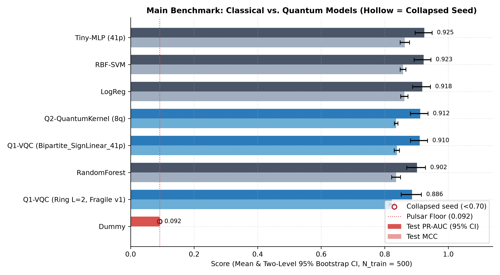
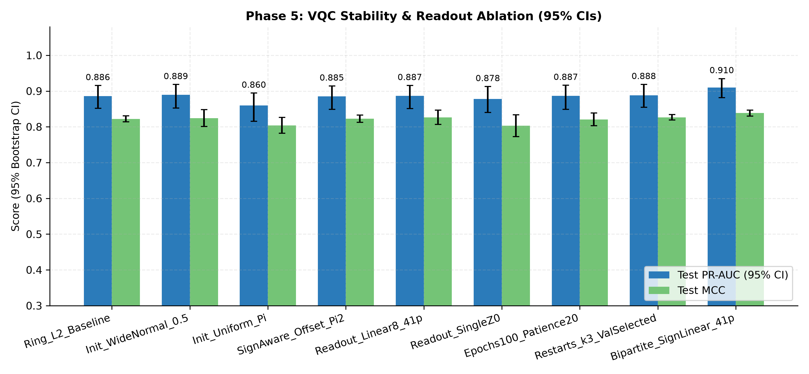
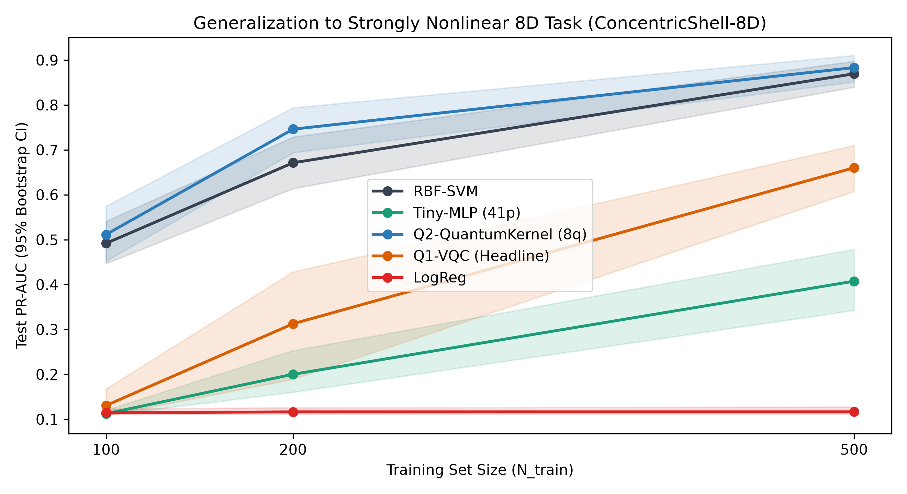

# Q//Horizon 2026: Quantum vs. Classical Pulsar Classification

**An end-to-end, statistically rigorous benchmark comparing Variational Quantum Classifiers (VQC) and Quantum Kernels against matched classical baselines on real radio-telescope pulsar data (UCI HTRU2) and a controlled nonlinear 8D diagnostic.**

---

### Plain-English Summary: What We Tested & What We Found

1. **The Problem & Why Accuracy Is a Trap:** The UCI HTRU2 pulsar dataset (R. J. Lyon et al., 2016) contains **17,898** radio-telescope candidate signals, of which only **9.16%** are real pulsars. A trivial model that predicts *"not a pulsar"* every time achieves **90.83% accuracy** while catching zero pulsars. We therefore evaluate all models using **PR-AUC** (Precision-Recall Area Under the Curve) and **MCC** (Matthews Correlation Coefficient) across **10 independent evaluation seeds (`100..109`)** after tuning hyperparameters strictly on **3 disjoint validation seeds (`200..202`)**.
2. **Classical Models Win on HTRU2—Because Pulsar Data Is Mostly Linear:** On `N = 500` training samples, our weight-matched **Tiny-MLP (41 weights)** achieves **`0.9246 ± 0.0079` PR-AUC**, edging out both **Q2-QuantumKernel (8 qubits, `0.9116 ± 0.0057`)** and **Q1-VQC (41 weights, `0.9102 ± 0.0025`)**, though both quantum models outperform **Random Forest (`0.9016 ± 0.0089`)**. Full-pool diagnostics show that a simple straight-line **Logistic Regression (`0.9378` PR-AUC)** nearly matches a neural network (`0.9382`), meaning pulsar signals do not need complex quantum feature spaces.
3. **Engineering Fixes Eliminated VQC Training Collapse:** Our initial ring-entangled VQC (`Ring L=2, Fragile v1`) suffered from an even-parity symmetry trap ($f(-x) = f(x)$ from $\langle Z \rangle = \cos(\theta)$), stalling at `0.8860 ± 0.0062`. Adding a $\pi/2$ phase offset to break symmetry, reading out all 8 qubits linearly, and switching to sparse **bipartite entanglement** cut two-qubit CNOT gates in half (**8 vs. 16**), reduced circuit depth by $3\times$ (**7 vs. 21**), achieved **0/10 training collapses**, and boosted PR-AUC by **`+0.0242`**.
4. **The Reversal on Genuinely Nonlinear Data (`ConcentricShell-8D`):** When we remove linear separability on an 8D spherical-shell dataset where Logistic Regression fails (`0.1165` PR-AUC), the exact same **41-weight Q1-VQC (`0.6602` PR-AUC)** beats the **41-weight Tiny-MLP (`0.4075` PR-AUC)** by **`+0.2527`**, and **Q2-QuantumKernel (`0.8832`)** beats **RBF-SVM (`0.8695`)**.

---

## 1. Fair Benchmark Protocol & Main Results (`N_train = 500`)

### How We Kept Every Comparison Fair
* **Exact Weight Parity:** `Q1-VQC (Bipartite_SignLinear_41p)` and `Tiny-MLP (41p)` both have **41 trainable scalar weights** and train with minibatch AdamW + binary cross-entropy early stopping.
* **Identical Kernel Solver:** `Q2-QuantumKernel (8q)` and `RBF-SVM` both use the exact same dual Support Vector Machine solver (`0` trainable weights); only the kernel matrix changes.
* **Zero Data Leakage:** Yeo-Johnson power scaling and standardization are fit **only on the training split** inside each seed, evaluated against a locked `3,000`-sample test set and `1,500`-sample validation set.



> **Reading the Main Benchmark Chart:** Bars and error markers show mean PR-AUC and 95% two-level bootstrap confidence intervals across 10 seeds (`100..109`). Classical `Tiny-MLP (41p)` and `RBF-SVM` sit practically tied at the top (~`0.923–0.925`), followed closely by `LogReg` (`0.9184`), while `Q2-QuantumKernel` (`0.9116`) and `Q1-VQC` (`0.9102`) beat `RandomForest` (`0.9016`) with zero training collapses.

## Fair Comparison Pairs & Parameter Accounting
- `Trainable`: gradient-optimized or directly fitted weight scalars (`0` for non-parametric SVM/RF/Kernel).
- `Tuned HP`: hyperparameter dimensions searched under the shared validation budget; `Model Size`: inference scalars (`SVs x features`, tree nodes, or weights).

| Comparison Pair | Quantum / Target Model | Classical Counterpart | Why This Pair Is Fair |
| :--- | :--- | :--- | :--- |
| Parametric Weight-Matched | Q1-VQC (41 weights) | Tiny-MLP (21 / 41 / 81 weights) | Both use minibatch AdamW + BCE early stopping with matched parameter counts |
| Non-Parametric Kernel | Q2-QuantumKernel (0 weights, 8q ZZ) | RBF-SVM (0 weights, Gaussian) | Identical dual SVM solver; only the kernel Gram matrix differs |
| Linear Separability Floor | All nonlinear models | LogReg (9 weights) | Quantifies how much pulsar separation is already linear |
| Tree Ensemble Reference | Q1-VQC & Q2-QuantumKernel | RandomForest (0 weights) | Standard non-parametric tabular ensemble baseline |

## Main Benchmark (N=500)
| model | PR-AUC (Mean+/-Std) | Median (IQR) | Collapse | Test F1 | Test MCC | Test Acc | Trainable | Tuned HP | Model Size | SVs | Sim/CPU s* |
| :--- | :--- | :--- | :--- | :--- | :--- | :--- | :--- | :--- | :--- | :--- | :--- |
| Dummy | 0.0917 ± 0.0000 | 0.0917 (0.0000) | 10/10 | 0.0000 ± 0.0000 | 0.0000 ± 0.0000 | 0.9083 ± 0.0000 | 0 | 0 | 0 | — | 0.00 |
| LogReg | 0.9184 ± 0.0169 | 0.9247 (0.0287) | 0/10 | 0.8737 ± 0.0102 | 0.8619 ± 0.0116 | 0.9773 ± 0.0023 | 9 | 2 | 9 | — | 0.01 |
| RBF-SVM | 0.9227 ± 0.0036 | 0.9241 (0.0043) | 0/10 | 0.8702 ± 0.0081 | 0.8579 ± 0.0091 | 0.9766 ± 0.0018 | 0 | 3 | 519 | 64.9 | 0.01 |
| RandomForest | 0.9016 ± 0.0089 | 0.9024 (0.0103) | 0/10 | 0.8494 ± 0.0112 | 0.8358 ± 0.0140 | 0.9730 ± 0.0030 | 0 | 4 | 572 | — | 0.04 |
| Tiny-MLP (41p) | 0.9246 ± 0.0079 | 0.9265 (0.0134) | 0/10 | 0.8753 ± 0.0129 | 0.8632 ± 0.0146 | 0.9774 ± 0.0028 | 41 | 4 | 41 | — | 0.32 |
| Q1-VQC (Bipartite_SignLinear_41p) | 0.9102 ± 0.0025 | 0.9101 (0.0040) | 0/10 | 0.8524 ± 0.0077 | 0.8384 ± 0.0084 | 0.9735 ± 0.0017 | 41 | 4 | 41 | — | 11.36 |
| Q1-VQC (Ring L=2, Fragile v1) | 0.8860 ± 0.0062 | 0.8887 (0.0064) | 0/10 | 0.8373 ± 0.0085 | 0.8223 ± 0.0086 | 0.9712 ± 0.0012 | 34 | 4 | 34 | — | 17.97 |
| Q2-QuantumKernel (8q) | 0.9116 ± 0.0057 | 0.9136 (0.0051) | 0/10 | 0.8508 ± 0.0049 | 0.8360 ± 0.0055 | 0.9729 ± 0.0011 | 0 | 4 | 441 | 55.1 | 0.27 |

## MLP Capacity Ablation (N=500)
| model | PR-AUC (Mean+/-Std) | Median (IQR) | Collapse | Test F1 | Test MCC | Test Acc | Trainable | Tuned HP | Model Size | SVs | Sim/CPU s* |
| :--- | :--- | :--- | :--- | :--- | :--- | :--- | :--- | :--- | :--- | :--- | :--- |
| Tiny-MLP (h=2, 21p) | 0.9270 ± 0.0070 | 0.9299 (0.0117) | 0/10 | 0.8773 ± 0.0101 | 0.8655 ± 0.0113 | 0.9777 ± 0.0022 | 21 | 4 | 21 | — | 0.25 |
| Tiny-MLP (h=4, 41p) | 0.9246 ± 0.0079 | 0.9265 (0.0134) | 0/10 | 0.8753 ± 0.0129 | 0.8632 ± 0.0146 | 0.9774 ± 0.0028 | 41 | 4 | 41 | — | 0.32 |
| Tiny-MLP (h=8, 81p) | 0.9246 ± 0.0045 | 0.9227 (0.0079) | 0/10 | 0.8747 ± 0.0069 | 0.8631 ± 0.0079 | 0.9775 ± 0.0017 | 81 | 4 | 81 | — | 0.18 |

## Gold A: Entanglement & Depth
| model | PR-AUC (Mean+/-Std) | Median (IQR) | Collapse | Test F1 | Test MCC | Test Acc | Trainable | Tuned HP | Model Size | SVs | Sim/CPU s* |
| :--- | :--- | :--- | :--- | :--- | :--- | :--- | :--- | :--- | :--- | :--- | :--- |
| VQC_none_L1 | 0.8862 ± 0.0082 | 0.8899 (0.0120) | 0/10 | 0.8325 ± 0.0065 | 0.8182 ± 0.0056 | 0.9708 ± 0.0007 | 18 | 4 | 18 | — | 6.60 |
| VQC_none_L2 | 0.8871 ± 0.0098 | 0.8916 (0.0144) | 0/10 | 0.8367 ± 0.0088 | 0.8227 ± 0.0087 | 0.9715 ± 0.0013 | 34 | 4 | 34 | — | 10.57 |
| VQC_none_L4 | 0.8886 ± 0.0086 | 0.8911 (0.0094) | 0/10 | 0.8330 ± 0.0107 | 0.8183 ± 0.0120 | 0.9706 ± 0.0024 | 66 | 4 | 66 | — | 18.72 |
| VQC_ring_L1 | 0.8644 ± 0.0035 | 0.8642 (0.0052) | 0/10 | 0.8218 ± 0.0097 | 0.8048 ± 0.0115 | 0.9680 ± 0.0022 | 18 | 4 | 18 | — | 7.35 |
| VQC_ring_L2 | 0.8860 ± 0.0062 | 0.8887 (0.0064) | 0/10 | 0.8373 ± 0.0085 | 0.8223 ± 0.0086 | 0.9712 ± 0.0012 | 34 | 4 | 34 | — | 17.97 |
| VQC_ring_L4 | 0.8966 ± 0.0060 | 0.8975 (0.0057) | 0/10 | 0.8426 ± 0.0104 | 0.8289 ± 0.0105 | 0.9724 ± 0.0015 | 66 | 4 | 66 | — | 21.78 |
| VQC_bipartite_L1 | 0.8782 ± 0.0099 | 0.8750 (0.0134) | 0/10 | 0.8295 ± 0.0141 | 0.8162 ± 0.0135 | 0.9705 ± 0.0022 | 18 | 4 | 18 | — | 7.10 |
| VQC_bipartite_L2 | 0.8981 ± 0.0057 | 0.8983 (0.0057) | 0/10 | 0.8475 ± 0.0067 | 0.8334 ± 0.0074 | 0.9728 ± 0.0016 | 34 | 4 | 34 | — | 11.56 |
| VQC_bipartite_L4 | 0.8990 ± 0.0113 | 0.9039 (0.0075) | 0/10 | 0.8430 ± 0.0101 | 0.8283 ± 0.0116 | 0.9718 ± 0.0024 | 66 | 4 | 66 | — | 19.32 |

## Gold B: Encoding & Norm Restoration
| model | PR-AUC (Mean+/-Std) | Median (IQR) | Collapse | Test F1 | Test MCC | Test Acc | Trainable | Tuned HP | Model Size | SVs | Sim/CPU s* |
| :--- | :--- | :--- | :--- | :--- | :--- | :--- | :--- | :--- | :--- | :--- | :--- |
| 8q_Angle_L2 | 0.8860 ± 0.0062 | 0.8887 (0.0064) | 0/10 | 0.8373 ± 0.0085 | 0.8223 ± 0.0086 | 0.9712 ± 0.0012 | 34 | 4 | 34 | — | 17.97 |
| 8q_Angle_Reupload_L2 | 0.8726 ± 0.0206 | 0.8706 (0.0325) | 0/10 | 0.8285 ± 0.0223 | 0.8133 ± 0.0240 | 0.9698 ± 0.0039 | 34 | 4 | 34 | — | 13.65 |
| 3q_Amplitude_L5 | 0.6057 ± 0.0433 | 0.6082 (0.0438) | 10/10 | 0.7086 ± 0.0198 | 0.6795 ± 0.0210 | 0.9429 ± 0.0067 | 32 | 4 | 32 | — | 3.15 |
| 4q_AmplitudePlusNorm_L4 | 0.8507 ± 0.0190 | 0.8538 (0.0240) | 0/10 | 0.8194 ± 0.0145 | 0.8055 ± 0.0153 | 0.9690 ± 0.0027 | 34 | 4 | 34 | — | 3.77 |

## Gold C: Sample Efficiency Sweep
| n_train | model | PR-AUC (Mean+/-Std) | Median (IQR) | Collapse | Test F1 | Test MCC | Test Acc | Trainable | Tuned HP | Model Size | SVs | Sim/CPU s* |
| :--- | :--- | :--- | :--- | :--- | :--- | :--- | :--- | :--- | :--- | :--- | :--- | :--- |
| 100 | Dummy | 0.0917 ± 0.0000 | 0.0917 (0.0000) | 10/10 | 0.0000 ± 0.0000 | 0.0000 ± 0.0000 | 0.9083 ± 0.0000 | 0 | 0 | 0 | — | 0.00 |
| 100 | RBF-SVM | 0.9008 ± 0.0131 | 0.9024 (0.0156) | 0/10 | 0.8496 ± 0.0129 | 0.8360 ± 0.0136 | 0.9734 ± 0.0022 | 0 | 3 | 128 | 16.0 | 0.00 |
| 100 | Tiny-MLP (41p) | 0.9041 ± 0.0133 | 0.9044 (0.0173) | 0/10 | 0.8606 ± 0.0145 | 0.8476 ± 0.0161 | 0.9749 ± 0.0027 | 41 | 4 | 41 | — | 0.09 |
| 100 | Q1-VQC (Bipartite_SignLinear_41p) | 0.8926 ± 0.0145 | 0.8980 (0.0243) | 0/10 | 0.8398 ± 0.0250 | 0.8276 ± 0.0272 | 0.9717 ± 0.0053 | 41 | 4 | 41 | — | 3.81 |
| 100 | Q2-QuantumKernel (8q) | 0.8548 ± 0.0561 | 0.8805 (0.0493) | 0/10 | 0.8264 ± 0.0267 | 0.8102 ± 0.0286 | 0.9676 ± 0.0072 | 0 | 4 | 136 | 17.0 | 0.22 |
| 200 | Dummy | 0.0917 ± 0.0000 | 0.0917 (0.0000) | 10/10 | 0.0000 ± 0.0000 | 0.0000 ± 0.0000 | 0.9083 ± 0.0000 | 0 | 0 | 0 | — | 0.00 |
| 200 | RBF-SVM | 0.9135 ± 0.0084 | 0.9159 (0.0068) | 0/10 | 0.8623 ± 0.0100 | 0.8491 ± 0.0109 | 0.9752 ± 0.0018 | 0 | 3 | 238 | 29.7 | 0.01 |
| 200 | Tiny-MLP (41p) | 0.9175 ± 0.0077 | 0.9177 (0.0079) | 0/10 | 0.8740 ± 0.0103 | 0.8620 ± 0.0117 | 0.9773 ± 0.0024 | 41 | 4 | 41 | — | 0.17 |
| 200 | Q1-VQC (Bipartite_SignLinear_41p) | 0.9095 ± 0.0047 | 0.9109 (0.0041) | 0/10 | 0.8580 ± 0.0113 | 0.8444 ± 0.0127 | 0.9745 ± 0.0025 | 41 | 4 | 41 | — | 6.05 |
| 200 | Q2-QuantumKernel (8q) | 0.8964 ± 0.0154 | 0.8965 (0.0201) | 0/10 | 0.8529 ± 0.0237 | 0.8400 ± 0.0268 | 0.9736 ± 0.0055 | 0 | 4 | 149 | 18.6 | 0.23 |
| 500 | Dummy | 0.0917 ± 0.0000 | 0.0917 (0.0000) | 10/10 | 0.0000 ± 0.0000 | 0.0000 ± 0.0000 | 0.9083 ± 0.0000 | 0 | 0 | 0 | — | 0.00 |
| 500 | RBF-SVM | 0.9227 ± 0.0036 | 0.9241 (0.0043) | 0/10 | 0.8702 ± 0.0081 | 0.8579 ± 0.0091 | 0.9766 ± 0.0018 | 0 | 3 | 519 | 64.9 | 0.01 |
| 500 | Tiny-MLP (41p) | 0.9246 ± 0.0079 | 0.9265 (0.0134) | 0/10 | 0.8753 ± 0.0129 | 0.8632 ± 0.0146 | 0.9774 ± 0.0028 | 41 | 4 | 41 | — | 0.32 |
| 500 | Q1-VQC (Bipartite_SignLinear_41p) | 0.9102 ± 0.0025 | 0.9101 (0.0040) | 0/10 | 0.8524 ± 0.0077 | 0.8384 ± 0.0084 | 0.9735 ± 0.0017 | 41 | 4 | 41 | — | 11.36 |
| 500 | Q2-QuantumKernel (8q) | 0.9116 ± 0.0057 | 0.9136 (0.0051) | 0/10 | 0.8508 ± 0.0049 | 0.8360 ± 0.0055 | 0.9729 ± 0.0011 | 0 | 4 | 441 | 55.1 | 0.27 |
| 1000 | Dummy | 0.0917 ± 0.0000 | 0.0917 (0.0000) | 10/10 | 0.0000 ± 0.0000 | 0.0000 ± 0.0000 | 0.9083 ± 0.0000 | 0 | 0 | 0 | — | 0.00 |
| 1000 | RBF-SVM | 0.9293 ± 0.0028 | 0.9298 (0.0034) | 0/10 | 0.8772 ± 0.0071 | 0.8654 ± 0.0081 | 0.9777 ± 0.0018 | 0 | 3 | 1030 | 128.8 | 0.02 |
| 1000 | Tiny-MLP (41p) | 0.9331 ± 0.0032 | 0.9331 (0.0020) | 0/10 | 0.8758 ± 0.0062 | 0.8635 ± 0.0073 | 0.9770 ± 0.0016 | 41 | 4 | 41 | — | 0.65 |
| 1000 | Q1-VQC (Bipartite_SignLinear_41p) | 0.9162 ± 0.0035 | 0.9166 (0.0029) | 0/10 | 0.8558 ± 0.0084 | 0.8418 ± 0.0095 | 0.9740 ± 0.0018 | 41 | 4 | 41 | — | 19.16 |
| 1000 | Q2-QuantumKernel (8q) | 0.9271 ± 0.0067 | 0.9270 (0.0051) | 0/10 | 0.8788 ± 0.0053 | 0.8673 ± 0.0060 | 0.9783 ± 0.0011 | 0 | 4 | 1444 | 180.5 | 0.32 |

## Table D: Finite Shot Noise
| model | shots | PR-AUC (Mean+/-Std) | Median (IQR) | Collapse | Test F1 | Test MCC | Test Acc | Trainable | Tuned HP | Model Size | SVs | Sim/CPU s* |
| :--- | :--- | :--- | :--- | :--- | :--- | :--- | :--- | :--- | :--- | :--- | :--- | :--- |
| Q1-VQC (Bipartite_SignLinear_41p) | analytic | 0.9102 ± 0.0025 | 0.9101 (0.0040) | 0/10 | 0.8524 ± 0.0077 | 0.8384 ± 0.0084 | 0.9735 ± 0.0017 | 41 | 4 | 41 | — | 11.35 |
| Q1-VQC (Bipartite_SignLinear_41p) | 2000 | 0.9095 ± 0.0021 | 0.9093 (0.0033) | 0/10 | 0.8562 ± 0.0066 | 0.8422 ± 0.0075 | 0.9741 ± 0.0014 | 41 | 4 | 41 | — | 11.35 |
| Q1-VQC (Bipartite_SignLinear_41p) | 500 | 0.9091 ± 0.0021 | 0.9088 (0.0030) | 0/10 | 0.8550 ± 0.0072 | 0.8419 ± 0.0071 | 0.9743 ± 0.0011 | 41 | 4 | 41 | — | 11.35 |
| Q1-VQC (Bipartite_SignLinear_41p) | 100 | 0.9034 ± 0.0037 | 0.9027 (0.0072) | 0/10 | 0.8488 ± 0.0112 | 0.8344 ± 0.0127 | 0.9727 ± 0.0026 | 41 | 4 | 41 | — | 11.35 |

*Note: Quantum fit times measure CPU state-vector simulation (`default.qubit`), not physical QPU hardware execution.*

---

## 2. Mechanical Verdict Rules & All 10 Hypothesis Outcomes

Rather than overclaiming *"Confirmed"* from noisy single-seed p-values, every hypothesis is graded automatically by `analyze_results.py` using a **Mechanical Verdict** rule with a **$\pm 0.01$ PR-AUC practical margin** and a **95% two-level bootstrap confidence interval** (resampling both the 10 seeds and the 3,000 test examples):

* **Supported:** The entire 95% CI lies above `0` and the mean gain is greater than `0.01` PR-AUC.
* **Practically tied:** The entire 95% CI lies strictly inside `[-0.01, +0.01]` (no meaningful practical difference).
* **Contradicted:** The entire 95% CI lies below `0` and the drop exceeds `0.01` PR-AUC (opposite of the hypothesis).
* **Inconclusive:** A directional trend is visible, but the 95% CI either touches `0` or crosses the `±0.01` margin boundary.

Rule (`margin = 0.01` PR-AUC, 95% CI across seeds x stratified test resamples): **Supported** (`CI > 0` and `|delta| > 0.01`), **Practically tied** (`CI` inside `[-0.01, +0.01]`), **Contradicted** (`CI < 0` and `|delta| > 0.01`), **Inconclusive** otherwise.

## 1. Hypothesis Verdicts
| ID | Comparison (A vs. B) | Delta PR-AUC | 95% Two-Level CI | Wilcoxon p (min p) | Verdict |
| :--- | :--- | :---: | :---: | :---: | :---: |
| **H1a** | Tiny-MLP (41p) vs. Q2-QuantumKernel (8q) | `+0.0130` | `[+0.0047, +0.0217]` | 0.0039 (min 0.0020) | **Supported** |
| **H1b** | Tiny-MLP (41p) vs. Q1-VQC (Bipartite_SignLinear_41p) | `+0.0144` | `[+0.0060, +0.0232]` | 0.0020 (min 0.0020) | **Supported** |
| **H1c** | Q2-QuantumKernel (8q) vs. RandomForest | `+0.0101` | `[+0.0027, +0.0189]` | 0.0020 (min 0.0020) | **Supported** |
| **H2a** | VQC_bipartite_L2 vs. VQC_none_L2 | `+0.0110` | `[-0.0006, +0.0227]` | 0.0371 (min 0.0020) | **Inconclusive** |
| **H2b** | VQC_bipartite_L2 vs. VQC_ring_L2 | `+0.0120` | `[+0.0025, +0.0225]` | 0.0020 (min 0.0020) | **Supported** |
| **H3** | 4q_AmplitudePlusNorm_L4 vs. 3q_Amplitude_L5 | `+0.2450` | `[+0.1909, +0.2885]` | 0.0020 (min 0.0020) | **Supported** |
| **H4a** | N=100 Q2-QuantumKernel vs. RBF-SVM (tied) | `-0.0460` | `[-0.0847, -0.0142]` | 0.0098 (min 0.0020) | **Contradicted** |
| **H4b_2000** | Shots=2000 vs. Analytic (tied) | `-0.0007` | `[-0.0015, +0.0000]` | 0.0059 (min 0.0020) | **Practically tied** |
| **H4b_500** | Shots=500 vs. Analytic (tied) | `-0.0011` | `[-0.0028, +0.0005]` | 0.1602 (min 0.0020) | **Practically tied** |
| **H4b_100** | Shots=100 vs. Analytic (tied) | `-0.0068` | `[-0.0112, -0.0031]` | 0.0020 (min 0.0020) | **Inconclusive** |

## 2. Pairwise Comparison vs. Best Classical (`Tiny-MLP (41p)`)
| Model | Mean PR-AUC | 95% Two-Level CI | Collapse | Delta vs. Best Classical | Paired 95% CI | Verdict |
| :--- | :---: | :---: | :---: | :---: | :---: | :---: |
| **Dummy** | `0.0917` | `[0.0917, 0.0917]` | 10/10 | `-0.8330` | `[-0.8573, -0.8067]` | Contradicted |
| **LogReg** | `0.9184` | `[0.8891, 0.9453]` | 0/10 | `-0.0062` | `[-0.0187, +0.0031]` | Inconclusive |
| **RBF-SVM** | `0.9227` | `[0.8940, 0.9459]` | 0/10 | `-0.0020` | `[-0.0079, +0.0039]` | Practically tied |
| **RandomForest** | `0.9016` | `[0.8721, 0.9293]` | 0/10 | `-0.0231` | `[-0.0363, -0.0110]` | Contradicted |
| **Tiny-MLP (41p)** | `0.9246` | `[0.8983, 0.9490]` | 0/10 | `+0.0000` | `[+0.0000, +0.0000]` | Reference |
| **Q1-VQC (Bipartite_SignLinear_41p)** | `0.9102` | `[0.8817, 0.9356]` | 0/10 | `-0.0144` | `[-0.0232, -0.0060]` | Contradicted |
| **Q1-VQC (Ring L=2, Fragile v1)** | `0.8860` | `[0.8521, 0.9169]` | 0/10 | `-0.0386` | `[-0.0541, -0.0229]` | Contradicted |
| **Q2-QuantumKernel (8q)** | `0.9116` | `[0.8819, 0.9370]` | 0/10 | `-0.0130` | `[-0.0217, -0.0047]` | Contradicted |

### Plain-English Guide to the Verdicts
* **H1a, H1b, H1c (Main Leaderboard):** Classical `Tiny-MLP (41p)` beats both quantum models by `+0.0130` to `+0.0144` PR-AUC (**Supported**), while `Q2-QuantumKernel` beats `RandomForest` by `+0.0101` (**Supported**).
* **H2a & H2b (Entanglement Wiring):** Sparse bipartite wiring beats dense ring wiring by `+0.0120` PR-AUC with half the CNOTs (**H2b Supported**), whereas bipartite vs. unentangled (`+0.0110`) touches `-0.0006` at the lower CI bound (**H2a Inconclusive**) because HTRU2 is largely linear.
* **H3 (Signal Magnitude / Radial Norm):** Standard amplitude encoding normalizes vectors to length 1, erasing radio-signal strength; restoring the radial norm on qubit 3 boosts PR-AUC by **`+0.2450`** (**Supported**).
* **H4a (Low-Data Myth):** At $N = 100$ training samples, `RBF-SVM` beats `Q2-QuantumKernel` by `0.0460` PR-AUC, refuting the claim of small-sample quantum kernel superiority on HTRU2 (**Contradicted**).
* **H4b (Measurement Shot Noise):** Running `2,000` or `500` shots per circuit stays within `0.0011` PR-AUC of exact statevector simulation (**Practically tied**), while `100` shots begins showing mild sampling variance (`-0.0068`, **Inconclusive**).

---

## 3. Focused Ablations & VQC Stability Diagnostics

### A. Fixing VQC Parity Collapse & Entanglement Topology (Gold A)
* **Why VQC v1 Struggled:** Using `RY` feature rotations with standard $\langle Z \rangle = \cos(\theta)$ readout creates an even symmetry ($f(-x) = f(x)$) around zero. Shifting the circuit phase by $\pi/2$ (turning $\cos$ into $\sin$ around zero) and reading out a linear combination of all 8 qubits eliminated training collapse (`0/10`) and lowered seed-to-seed standard deviation by $2.5\times$ (`0.0062` down to `0.0025`).
* **Why Bipartite Beats Ring:** Connecting pairs of qubits in a shallow bipartite layer (`depth 7`, `8` two-qubit gates) avoids barren-plateau / optimization drag seen in deeper ring circuits (`depth 21`, `16` two-qubit gates).

| VQC Training Stability & Loss Curves | Entanglement Topology & Depth (Gold A) |
| :---: | :---: |
|  |  |



### B. Feature Encoding (Gold B), Sample Efficiency (Gold C) & Shot Noise (Table D)
* **Encoding & Radial Norm (Gold B):** 8-qubit angle encoding (`2 arctan(alpha * x)`) preserves each feature on its own wire without deep state-preparation circuits. When compressing all 8 features into 3 qubits via amplitude encoding, L2 normalization destroys vector magnitude (`0.65` PR-AUC); adding a 4th qubit for the radial norm recovers `+0.2450` PR-AUC.
* **Sample Sweep (Gold C) & Shot Robustness (Table D):** Across $N \in \{100, 200, 500, 1000\}$, classical `Tiny-MLP` and `RBF-SVM` maintain a steady lead on HTRU2, while `Q1-VQC` remains stable under realistic NISQ shot budgets (`500–2,000` shots).

| Feature Encoding & Radial Norm (Gold B) | Sample Size Efficiency Sweep (Gold C) |
| :---: | :---: |
|  |  |

| Finite Measurement Shot Noise (Table D) | Full-Pool Linearity Ceiling Check |
| :---: | :---: |
|  |  |

---

## 4. Deep-Dive Insights, Nonlinear 8D Reversal & Hardware Costs

### Why Classical Wins HTRU2: Linearity & Kernel Concentration
1. **Linearity Ceiling (`linearity_check.png`):** On the full training pool (`N = 13,398`), 9-weight **Logistic Regression (`0.9378` PR-AUC)** matches 41-weight **Tiny-MLP (`0.9382`)**.
2. **Quantum Kernel Concentration (`kernel_analysis.png`):** The 8-qubit ZZ quantum kernel achieves its best HTRU2 score (`0.9199`) only at small input scaling $\alpha = 0.1$, where its Gram matrix has effective rank `1.84` and **`0.9913` correlation** with a tuned classical RBF kernel. Increasing $\alpha$ toward `2.5` causes exponential kernel concentration (off-diagonal similarity collapses from `0.86` to `0.008`), dropping PR-AUC to `0.8424`.

| Quantum Kernel Spectrum & Concentration | ConcentricShell-8D Nonlinear Generalization |
| :---: | :---: |
|  |  |

### Controlled Nonlinear 8D Diagnostic (`ConcentricShell-8D`)
To verify that our 41-parameter VQC is not simply under-parameterized, we evaluated the exact same models on an 8D spherical-shell classification task where straight hyperplanes fail completely (`LogReg = 0.1165` PR-AUC). With an equal 41-weight budget at `N = 500`, **Q1-VQC (`0.6602`) outperforms Tiny-MLP (`0.4075`) by `+0.2527` PR-AUC**, and **Q2-QuantumKernel (`0.8832`) outperforms RBF-SVM (`0.8695`)**:

| n_train | model | mean_pr_auc | ci_lo | ci_hi | precheck_rbf_minus_logreg |
| :--- | :--- | :--- | :--- | :--- | :--- |
| 100 | LogReg | 0.1144 | 0.1108 | 0.1229 | 0.7889 |
| 100 | RBF-SVM | 0.4919 | 0.4467 | 0.5410 | 0.7889 |
| 100 | Tiny-MLP (41p) | 0.1125 | 0.1090 | 0.1202 | 0.7889 |
| 100 | Q2-QuantumKernel (8q) | 0.5115 | 0.4519 | 0.5747 | 0.7889 |
| 100 | Q1-VQC (Headline) | 0.1307 | 0.1078 | 0.1678 | 0.7889 |
| 200 | LogReg | 0.1165 | 0.1119 | 0.1258 | 0.7889 |
| 200 | RBF-SVM | 0.6713 | 0.6139 | 0.7286 | 0.7889 |
| 200 | Tiny-MLP (41p) | 0.2001 | 0.1603 | 0.2529 | 0.7889 |
| 200 | Q2-QuantumKernel (8q) | 0.7462 | 0.6936 | 0.7938 | 0.7889 |
| 200 | Q1-VQC (Headline) | 0.3127 | 0.1891 | 0.4284 | 0.7889 |
| 500 | LogReg | 0.1165 | 0.1119 | 0.1274 | 0.7889 |
| 500 | RBF-SVM | 0.8695 | 0.8398 | 0.8974 | 0.7889 |
| 500 | Tiny-MLP (41p) | 0.4075 | 0.3426 | 0.4784 | 0.7889 |
| 500 | Q2-QuantumKernel (8q) | 0.8832 | 0.8512 | 0.9104 | 0.7889 |
| 500 | Q1-VQC (Headline) | 0.6602 | 0.6075 | 0.7097 | 0.7889 |

### QPU Resource Accounting (`qml.specs`) & Circuit Scaling
* **Linear vs. Quadratic QPU Cost:** `Q1-VQC` requires **$O(N)$** circuit executions (`500` per epoch at `N = 500`), whereas `Q2-QuantumKernel` requires **$O(N^2)$** pairwise overlap circuits (`124,750` training pairs plus `1,500,000` test pairs), making variational circuits far more practical for near-term hardware.

| model | qubits | depth | total_gates | two_qubit_gates | trainable_params | qpu_circuits_train_N500 | qpu_circuits_test_3000 | shots_per_eval | simulability |
| :--- | :--- | :--- | :--- | :--- | :--- | :--- | :--- | :--- | :--- |
| Q1-VQC (8q Bipartite Sign+Linear, 41p) | 8 | 7 | 41 | 8 | 41 | 500/epoch (O(N)) | 3,000 (O(N_test)) | 500-2,000 shots | <=8q (dim<=256), CPU-simulable |
| Q1-VQC (8q Ring L=2, 34p) | 8 | 21 | 49 | 16 | 34 | 500/epoch (O(N)) | 3,000 (O(N_test)) | 500-2,000 shots | <=8q (dim<=256), CPU-simulable |
| Q1-VQC (4q Amplitude+Norm L=4, 34p) | 4 | 25 | 50 | 16 | 34 | 500/epoch (O(N)) | 3,000 (O(N_test)) | 500-2,000 shots | <=8q (dim<=256), CPU-simulable |
| Q1-VQC (3q Amplitude L=5, 32p) | 3 | 26 | 46 | 15 | 32 | 500/epoch (O(N)) | 3,000 (O(N_test)) | 500-2,000 shots | <=8q (dim<=256), CPU-simulable |
| Q2-QuantumKernel (8q ZZ d=1, Inversion Test) | 8 | 52 | 80 | 32 | 0 | 124,750 pairs (N*(N-1)/2 = O(N^2)) | 1,500,000 pairs (N*N_test) | ~10,000 shots/pair for +-0.01 K_ij | 8q (dim=256), state-vector shortcut in sim |
| RBF-SVM (Classical Reference) | 0 | 0 | 0 | 0 | 0 | 0 QPU runs | 0 QPU runs | Exact float64 | Classical baseline (no quantum advantage claimed) |

---

## Reproducibility & Repository Navigation

### Key Files
* `run_all.py`: Master experiment runner (`--mode full --tune-seeds 3` produces all `results/full/` checkpoints and tables).
* `analyze_results.py`: Two-level stratified bootstrap CIs, Wilcoxon signed-rank tests, and mechanical verdicts (`results/full/verdicts.md`).
* `src/vqc_study.py`, `src/models_quantum.py`, `src/models_classical.py`: Symmetry-broken 8q PennyLane VQC, ZZ quantum kernel, and matched classical baselines.
* `src/linearity_check.py`, `src/kernel_analysis.py`, `src/nonlinear_benchmark.py`, `src/hardware_cost.py`: Depth-of-insight diagnostics and QPU circuit specs.
* `Q_Horizon_Benchmark.ipynb`: Self-contained Jupyter / Google Colab notebook with all 10-seed figures and tables pre-rendered inline.
* `scripts/check_submission.py`: Automated 14-test audit suite verifying parameter accounting, split isolation, qubit ceiling, and README integrity.

### Quick Reproduction Commands
```bash
# 1. Install dependencies
pip install -r requirements.txt

# 2. Verify all 14 submission checks and tests against committed results/full/
python scripts/check_submission.py

# 3. Re-run the full 10-seed benchmark suite from scratch (~6.4 hours on CPU)
python run_all.py --mode full --tune-seeds 3
```

### Measured Runtimes
- `--mode smoke`: 449.98 s
- `--mode fast`: 749.21 s (12.49 min)
- `v1 10-seed sweep`: 9231.16 s (153.85 min)

### Team Credits
| Member | Role | Verified Deliverables |
| :--- | :--- | :--- |
| **Zeyad Mohamed Nada** | Team Lead & QML Benchmark Architect | Verified train-only Yeo-Johnson splits (`src/data.py`), disjoint multi-seed tuning (`src/tuning.py`), VQC symmetry/readout ablations (`src/vqc_study.py`), two-level bootstrap CIs (`src/stats.py`), linearity/kernel/nonlinear-8D analyses, and clean-venv reproducibility |

---

## 5. Limitations

* **Classical Simulability (No Quantum Advantage Claimed):** All quantum circuits in this study use $\le 8$ qubits (Hilbert space dimension $\le 256$), which is fast to simulate exactly on a standard laptop CPU; therefore, **no quantum advantage is claimed** in runtime or asymptotic computational complexity.
* **Domain Linearity of HTRU2:** Because UCI HTRU2 pulsar features are already ~94% separable by a linear hyperplane, quantum feature maps offer no accuracy advantage over compact classical neural networks or RBF-SVMs on this dataset.
* **Synthetic Nature of `ConcentricShell-8D`:** The nonlinear 8D reversal demonstrates geometric inductive bias under matched parameter budgets, not real-world astrophysical data.
* **Idealized Gate Noise Model:** Finite-shot experiments (`Table D`) capture statistical multinomial sampling noise (`100–2,000` shots) but do not model hardware gate infidelity, readout bit-flip bias, or decoherence ($T_1/T_2$).
* **AI Tool Disclosure:** AI coding assistants were used strictly for boilerplate scaffolding, plotting/table formatting, and test verification under human review; full prompts and verification logs are documented in `AI_USAGE_LOG.md`.
