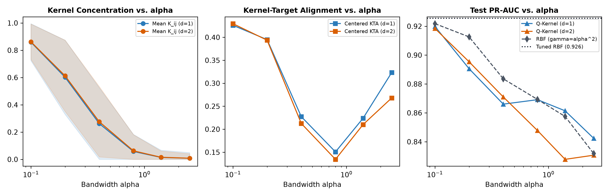

<div align="center">

<h4>Q // HORIZON 2026 &nbsp;&middot;&nbsp; KUBITS TEAM: Zeyad, Youssef, Omar</h4>

# Pulsar Signal Classification

**Benchmarking Variational Quantum Circuits and Quantum Kernels Against Classical Baselines**

[](https://zeyadmsn07.github.io/qhorizon-2026/)
[](Q_Horizon_Benchmark.ipynb)
[](results/full/summary_tables.md)
[](AI_USAGE_LOG.md)

<sub><b>Dataset:</b> UCI HTRU2 (17,898 candidates, 9.16% pulsars) &nbsp;&middot;&nbsp; <b>Circuit Size:</b> Up to 8 qubits &nbsp;&middot;&nbsp; <b>Protocol:</b> 3 tune seeds / 10 test seeds &nbsp;&middot;&nbsp; <b>Stack:</b> PennyLane, PyTorch, scikit-learn</sub>

</div>

---

## Introduction

Finding pulsars in radio-telescope surveys requires separating rare, periodic neutron-star signals from heavy background noise and human-made radio interference. For this study, we selected the **UCI HTRU2 Pulsar Candidate Dataset** (R. J. Lyon et al., 2016, ID `372`), which contains 17,898 real candidate detections from the High Time Resolution Universe Survey. Each candidate is described by 8 continuous measurements: four statistics from the folded pulse profile (mean, standard deviation, kurtosis, and skewness) and four corresponding statistics from the dispersion-measure signal-to-noise (DM-SNR) curve.

We chose HTRU2 because it tests quantum models on a realistic scientific problem without artificial preprocessing:

1. Its 8 features map directly onto 8 qubits without dimensionality reduction or dropped variables, staying comfortably within our 10-qubit ceiling while allowing us to pair the 4 pulse-profile wires directly with the 4 DM-SNR wires.
2. Only 9.16% of candidates are real pulsars, and several features have heavy outlier tails. Guessing noise every time gives 90.83% accuracy while catching zero pulsars, so every model has to be evaluated with Precision-Recall AUC (PR-AUC) and Matthews Correlation Coefficient (MCC) under leakage-free power scaling.
3. Well-engineered physics summaries give classical models a strong baseline, making HTRU2 an honest benchmark rather than a cherry-picked dataset. To separate dataset linearity from circuit capacity, we also test every model on a controlled 8-dimensional nonlinear task (`ConcentricShell-8D`).

---

## How to Run and Explore Results

To make our results intuitive and easier to understand without digging through raw CSV files, we built an interactive landing page where you can switch between datasets, hover over 10-seed confidence intervals, and step through each experiment visually. You can explore the dashboard and run the full benchmark either online or offline.

### Method 1: Online (Browser and Google Colab)

* Open the hosted interactive landing page directly in your browser with no setup required: **[https://zeyadmsn07.github.io/qhorizon-2026/](https://zeyadmsn07.github.io/qhorizon-2026/)**
* To execute the code in the cloud, open [`Q_Horizon_Benchmark.ipynb`](Q_Horizon_Benchmark.ipynb) (or [`Q_Horizon_Dashboard.ipynb`](Q_Horizon_Dashboard.ipynb)) in Google Colab from this repository, run `pip install -r requirements.txt` in the first cell, and run all cells from top to bottom.

### Method 2: Offline (Local Dashboard and CLI)

Because the dataset is cached locally in `data_cache/htru2.csv`, the entire project runs offline after cloning the repository or downloading the ZIP archive.

* Double-click `dashboard/qhorizon_dashboard.html` to open the standalone interactive page in Chrome, Edge, Firefox, or Safari (or run `python dashboard/serve.py` to rebuild and serve it locally).
* Run the test suite or reproduce the experiments from a terminal:

```bash
# 1. Install dependencies
pip install -r requirements.txt

# 2. Run all 14 automated unit tests and submission checks (~5 seconds)
python scripts/check_submission.py

# 3. Run a quick end-to-end verification pass (~7.5 minutes -> results/smoke/)
python run_all.py --mode smoke

# 4. Run a medium 3-seed pass (~12.5 minutes -> results/fast/)
python run_all.py --mode fast

# 5. Reproduce the full 10-seed benchmark from scratch (writes to results/full/)
python run_all.py --mode full --tune-seeds 3
python analyze_results.py --results-dir results/full
python -m src.plot_results --results-dir results/full
```

---

## Summary of Findings

* Classical models finish slightly ahead on HTRU2 because the dataset is already nearly linearly separable. At $N = 500$ training samples, our 41-weight `Tiny-MLP` reaches `0.9246` PR-AUC and `RBF-SVM` reaches `0.9227`, ahead of `Q2-QuantumKernel` (`0.9116`) and the 41-weight `Q1-VQC` (`0.9102`). Against `RandomForest` (`0.9016`), only `Q2-QuantumKernel` clears our $\pm 0.01$ practical margin (`+0.0101`), while `Q1-VQC` (`+0.0086`) falls inside the practical-tie band. On the full 13,398-sample training pool, a 9-weight linear `LogReg` reaches `0.9377` PR-AUC, nearly matching `Tiny-MLP` (`0.9394`).
* Multi-seed validation tuning and a combined circuit redesign stabilized VQC training. In our initial single-seed-tuned baseline, the ring-entangled circuit (`Ring L=2`) collapsed below `0.70` PR-AUC on 2 of 10 seeds (`0.7800`). Moving to 3 disjoint validation seeds (`200..202`) eliminated all collapses on `Ring L=2` (`0.8860`, `0/10` collapses). Adding a $\pi/2$ phase shift alone (`0.8854`) or an 8-wire linear readout alone (`0.8869`) made no standalone difference, whereas combining sparse bipartite wiring (8 CNOTs instead of 16; depth 7 instead of 21) with the $\pi/2$ shift and 8-wire linear readout raised PR-AUC to `0.9102`.
* On our synthetic 8D inner-ball task (`ConcentricShell-8D`), linear `LogReg` fails (`0.1165`), while `Q2-QuantumKernel` (`0.8832`) and `RBF-SVM` (`0.8695`) finish in a statistical tie with overlapping 95% confidence intervals. At $N = 500$, the 41-weight `Q1-VQC` (`0.6602`) beats the 4-neuron `Tiny-MLP` (`0.4075`) after struggling at $N = 100$ (`0.1307`) and $N = 200$ (`0.3127`). Follow-up width checks show this gap comes from two design factors: the synthetic label is even in every coordinate ($f(-x) = f(x)$), aligning with $\cos(\cdot)$ angle rotations, and 4 hidden neurons bottleneck radial closure. Widening `Tiny-MLP` to 8, 16, and 32 neurons lifts PR-AUC to `0.5936`, `0.6195`, and `0.7767`, overtaking `Q1-VQC`.

---

## 1. Fair Benchmark at $N = 500$

Every tunable model searches 20 hyperparameter configurations on 3 disjoint validation seeds (`200..202`) before being evaluated across 10 independent seeds (`100..109`). Yeo-Johnson power scaling is fit strictly on `X_train` inside each seed, and decision thresholds are selected on the 1,500-sample validation split before scoring once on the locked 3,000-sample test split.

* `Q1-VQC (Bipartite_SignLinear_41p)` and `Tiny-MLP (41p)` both train 41 scalar weights with minibatch AdamW and binary cross-entropy early stopping, backed by MLP width checks (`21p` to `321p`).
* `Q2-QuantumKernel (8q)` and `RBF-SVM` use the exact same dual Support Vector Machine solver with zero gradient-trained weights; only the kernel matrix changes.


| Model | PR-AUC (Mean $\pm$ Std) | Collapse | Test F1 | Test MCC | Test Acc | Weights | Tuned HP | SVs | CPU s* |
| :--- | :---: | :---: | :---: | :---: | :---: | :---: | :---: | :---: | :---: |
| Dummy | $0.0917 \pm 0.0000$ | 10/10 | $0.0000 \pm 0.0000$ | $0.0000 \pm 0.0000$ | $0.9083 \pm 0.0000$ | 0 | 0 | -- | 0.00 |
| LogReg | $0.9184 \pm 0.0169$ | 0/10 | $0.8737 \pm 0.0102$ | $0.8619 \pm 0.0116$ | $0.9773 \pm 0.0023$ | 9 | 2 | -- | 0.01 |
| RBF-SVM | $0.9227 \pm 0.0036$ | 0/10 | $0.8702 \pm 0.0081$ | $0.8579 \pm 0.0091$ | $0.9766 \pm 0.0018$ | 0 | 3 | 64.9 | 0.01 |
| RandomForest | $0.9016 \pm 0.0089$ | 0/10 | $0.8494 \pm 0.0112$ | $0.8358 \pm 0.0140$ | $0.9730 \pm 0.0030$ | 0 | 4 | -- | 0.04 |
| **Tiny-MLP (41p)** | $0.9246 \pm 0.0079$ | 0/10 | $0.8753 \pm 0.0129$ | $0.8632 \pm 0.0146$ | $0.9774 \pm 0.0028$ | 41 | 4 | -- | 0.32 |
| Q1-VQC (Bipartite_SignLinear_41p) | $0.9102 \pm 0.0025$ | 0/10 | $0.8524 \pm 0.0077$ | $0.8384 \pm 0.0084$ | $0.9735 \pm 0.0017$ | 41 | 4 | -- | 11.36 |
| Q1-VQC (Ring L=2, Fragile v1) | $0.8860 \pm 0.0062$ | 0/10 | $0.8373 \pm 0.0085$ | $0.8223 \pm 0.0086$ | $0.9712 \pm 0.0012$ | 34 | 4 | -- | 17.97 |
| Q2-QuantumKernel (8q) | $0.9116 \pm 0.0057$ | 0/10 | $0.8508 \pm 0.0049$ | $0.8360 \pm 0.0055$ | $0.9729 \pm 0.0011$ | 0 | 4 | 55.1 | 0.27 |

*Quantum fit times measure PennyLane `default.qubit` CPU statevector simulation rather than physical QPU execution. Full medians, IQRs, and HTRU2 MLP capacity checks (`21p = 0.9270`, `41p = 0.9246`, `81p = 0.9246`) are recorded in [`results/full/summary_tables.md`](results/full/summary_tables.md).*

---

## 2. Statistical Verdicts

Every hypothesis is graded automatically by `analyze_results.py` using a **Mechanical Verdict** rule with a $\pm 0.01$ PR-AUC practical margin and a 95% two-level bootstrap confidence interval (jointly resampling the 10 seeds and the 3,000 stratified test examples):

* Supported means the entire 95% CI lies above `0` and the mean gain exceeds `0.01` PR-AUC.
* Practically tied means the entire 95% CI sits inside `[-0.01, +0.01]`.
* Contradicted means the entire 95% CI lies below `0` with a drop beyond `0.01` PR-AUC (or outside the tie band for tie hypotheses).
* Inconclusive means the 95% CI touches `0` or crosses the $\pm 0.01$ margin boundary.

| ID | Comparison (Model A vs. Model B) | $\Delta$ PR-AUC | 95% Two-Level CI | Wilcoxon $p$ | Verdict |
| :--- | :--- | :---: | :---: | :---: | :---: |
| `H1a` | Tiny-MLP (41p) vs. Q2-QuantumKernel (8q) | `+0.0130` | `[+0.0047, +0.0217]` | 0.0039 | **Supported** |
| `H1b` | Tiny-MLP (41p) vs. Q1-VQC (Bipartite_SignLinear_41p) | `+0.0144` | `[+0.0060, +0.0232]` | 0.0020 | **Supported** |
| `H1c` | Q2-QuantumKernel (8q) vs. RandomForest | `+0.0101` | `[+0.0027, +0.0189]` | 0.0020 | **Supported** |
| `H2a` | VQC_bipartite_L2 vs. VQC_none_L2 | `+0.0110` | `[-0.0006, +0.0227]` | 0.0371 | **Inconclusive** |
| `H2b` | VQC_bipartite_L2 vs. VQC_ring_L2 | `+0.0120` | `[+0.0025, +0.0225]` | 0.0020 | **Supported** |
| `H3` | 4q_AmplitudePlusNorm_L4 vs. 3q_Amplitude_L5 | `+0.2450` | `[+0.1909, +0.2885]` | 0.0020 | **Supported** |
| `H4a` | N=100 Q2-QuantumKernel vs. RBF-SVM (tied) | `-0.0460` | `[-0.0847, -0.0142]` | 0.0098 | **Contradicted** |
| `H4b_2000` | Shots=2000 vs. Analytic (tied) | `-0.0007` | `[-0.0015, +0.0000]` | 0.0059 | **Practically tied** |
| `H4b_500` | Shots=500 vs. Analytic (tied) | `-0.0011` | `[-0.0028, +0.0005]` | 0.1602 | **Practically tied** |
| `H4b_100` | Shots=100 vs. Analytic (tied) | `-0.0068` | `[-0.0112, -0.0031]` | 0.0020 | **Inconclusive** |

---

## 3. Circuit Ablations and Shot Noise

### Entanglement Wiring, Readout, and Stability

In our first single-seed-tuned baseline, `Ring L=2` picked a narrow input scale ($\alpha = 0.25$) where `RY` rotations with $\langle Z \rangle = \cos(\theta)$ readout start nearly blind to feature sign ($+x$ vs. $-x$), causing 2 of 10 seeds to stall. Tuning across 3 disjoint validation seeds brought `Ring L=2` to `0/10` collapses (`0.8860`). Testing individual changes (`docs/vqc_stability.md`) showed that neither the $\pi/2$ sign shift (`0.8854`) nor the 8-wire linear readout (`0.8869`) improved `Ring L=2` alone. Switching from ring to domain-paired bipartite wiring added `+0.0120` (`VQC_bipartite_L2` = `0.8981`), and combining bipartite wiring with the $\pi/2$ shift and 8-wire linear readout added another `+0.0121` (`0.9102`) with half the CNOT gates.

| VQC Loss Curves (Seed 100 vs. Seed 105) | Entanglement & Depth (Gold A) |
| :---: | :---: |
|  |  |


### Feature Encoding, Sample Sweep, and Measurement Shots

* Compressing 8 features into 3 qubits with amplitude encoding normalizes each vector to unit length, erasing signal magnitude and dropping PR-AUC to `0.6057`. Restoring the L2 norm on a 4th qubit recovers `+0.2450` PR-AUC (`0.8507`), while 8-qubit angle encoding (`2 arctan(alpha * x)`) keeps each feature on its own wire without state-preparation overhead.
* Across $N \in \{100, 200, 500, 1000\}$, standalone `Tiny-MLP` and `RBF-SVM` stay ahead of standalone quantum models at every sample size. Blending `Q1-VQC` and `Tiny-MLP` probabilities at $N = 100$ produces a smooth validation peak around a 20%--30% VQC weight (`0.9132` test PR-AUC, `+0.0091` over `Tiny-MLP` alone), which stays inside the $\pm 0.01$ tie band and vanishes by $N = 500$ (`+0.0009`).
* Finite-shot inference on `Q1-VQC` stays practically tied with exact analytic readout at `2,000` shots (`0.9095`) and `500` shots (`0.9091`), showing mild sampling variance only at `100` shots (`0.9034`).

| Feature Encoding & Norm (Gold B) | Sample Efficiency Sweep (Gold C) |
| :---: | :---: |
|  |  |

| Finite Shot Noise (Table D) | Full-Pool Linearity Ceiling |
| :---: | :---: |
|  |  |

---

## 4. Diagnostics and Hardware Cost

### HTRU2 Linearity and Quantum Kernel Concentration

On the full 13,398-sample training pool with validation-tuned hyperparameters, 9-weight `LogReg` (`0.9377`), 41-weight `Tiny-MLP` (`0.9394`), 45-weight `Poly2-LogReg` (`0.9411`), and `RBF-SVM` (`0.9309`) all cluster within roughly `0.01` PR-AUC, confirming how little nonlinear headroom exists on HTRU2. Meanwhile, the 8-qubit ZZ kernel peaks at the lower boundary of its search grid ($\alpha = 0.1$, effective rank `1.84`, `0.9913` correlation with tuned RBF). Probing smaller scales ($\alpha = 0.05, 0.02$) nudges single-seed PR-AUC to `0.9281`--`0.9287` only because the ZZ Gram matrix collapses into a rank-`1.05` classical kernel, whereas larger $\alpha$ values trigger exponential off-diagonal concentration (`0.008` at $\alpha = 2.5$).

| Quantum Kernel Spectrum & Concentration | ConcentricShell-8D Generalization |
| :---: | :---: |
|  |  |

### Controlled Nonlinear 8D Diagnostic (`ConcentricShell-8D`)

`ConcentricShell-8D` labels the innermost 12% of a perturbed 4D ball embedded in 8D ($r^2 = \sum_{i=0}^3 x_i^2 + 0.35\sin(2.5 x_0 x_1) \le q_{0.12}$ plus 4 Gaussian noise coordinates; despite the code name, the positive class is an inner ball rather than a hollow shell). Linear `LogReg` fails (`0.1165`), while `Q2-QuantumKernel` (`0.8832`) and `RBF-SVM` (`0.8695`) statistically tie across sample sizes. With 41 weights, `Q1-VQC` scores `0.1307` at $N = 100$, `0.3127` at $N = 200$, and `0.6602` at $N = 500$ against `0.4075` for the 4-unit `Tiny-MLP`, while widening `Tiny-MLP` to 8, 16, and 32 units reaches `0.5936`, `0.6195`, and `0.7767` (`results/full/diagnostics_extra/concentric_mlp_width_sweep.csv`).

| $N_{\text{train}}$ | LogReg | RBF-SVM | Tiny-MLP (41p) | Q2-QuantumKernel (8q) | Q1-VQC (41p) |
| :---: | :---: | :---: | :---: | :---: | :---: |
| 100 | 0.1144 | 0.4919 | 0.1125 | 0.5115 | 0.1307 |
| 200 | 0.1165 | 0.6713 | 0.2001 | 0.7462 | 0.3127 |
| 500 | 0.1165 | 0.8695 | 0.4075 | 0.8832 | 0.6602 |

### Physical QPU Resource Accounting (`qml.specs`)

`Q1-VQC` scales linearly in dataset size ($O(N)$: `500` circuits per epoch and `3,000` test circuits), whereas `Q2-QuantumKernel` requires $O(N^2)$ pairwise overlap circuits (`124,750` training pairs plus `1,500,000` test pairs at $N = 500$).

| Circuit Architecture | Qubits | Depth | Total Gates | 2Q Gates | Weights | Train Executions ($N=500$) | Test Executions ($3,000$) |
| :--- | :---: | :---: | :---: | :---: | :---: | :--- | :--- |
| Q1-VQC (8q Bipartite Sign+Linear) | 8 | 7 | 41 | 8 | 41 | 500 / epoch ($O(N)$) | 3,000 ($O(N_{\text{test}})$) |
| Q1-VQC (8q Ring L=2) | 8 | 21 | 49 | 16 | 34 | 500 / epoch ($O(N)$) | 3,000 ($O(N_{\text{test}})$) |
| Q1-VQC (4q Amplitude+Norm L=4) | 4 | 25 | 50 | 16 | 34 | 500 / epoch ($O(N)$) | 3,000 ($O(N_{\text{test}})$) |
| Q1-VQC (3q Amplitude L=5) | 3 | 26 | 46 | 15 | 32 | 500 / epoch ($O(N)$) | 3,000 ($O(N_{\text{test}})$) |
| Q2-QuantumKernel (8q ZZ d=1) | 8 | 52 | 80 | 32 | 0 | 124,750 pairs ($O(N^2)$) | 1,500,000 pairs ($N \cdot N_{\text{test}}$) |

---

## 5. Limitations

* All circuits use $\le 8$ qubits ($2^8 = 256$ amplitudes) and run quickly on a standard laptop CPU, so no quantum advantage is claimed in runtime or computational complexity.
* HTRU2 is roughly 94% separable by a linear hyperplane, leaving minimal room for nonlinear feature maps; on this dataset, `Q2-QuantumKernel` peaks near the small-$\alpha$ boundary ($\alpha \le 0.1$) where it behaves like a low-rank classical kernel.
* `ConcentricShell-8D` is synthetic, its even coordinate symmetry ($f(-x) = f(x)$) aligns directly with $\cos(\cdot)$ angle encoding, and fixing `Tiny-MLP` to 4 hidden neurons creates a geometric width bottleneck (`32` hidden units reach `0.7767` PR-AUC, surpassing `Q1-VQC` at `0.6602`).
* Finite-shot experiments (`100`--`2,000` shots) model statistical multinomial measurement noise only and do not simulate gate infidelity, readout bit-flip bias, or hardware decoherence ($T_1/T_2$).

---

## Credits and References

* UCI HTRU2 Pulsar Candidate Dataset (ID `372`), R. J. Lyon, B. W. Stappers, S. Cooper, J. M. Brooke, and J. D. Knowles (2016), *MNRAS* 459(1), 1104--1123 (`DOI: 10.24432/C5DK6R`, CC BY 4.0; see [`DATA_LICENSE.md`](DATA_LICENSE.md)).
* Quantum circuits are simulated with **PennyLane** (`default.qubit`), and classical models are implemented with **PyTorch** and **scikit-learn**.
* All AI-assisted code scaffolding, diagnostic checks, and human verification steps are logged in [`AI_USAGE_LOG.md`](AI_USAGE_LOG.md).
* Built by **Kubits Team** (Zeyad Mohamed Nada, Youssef, and Omar; see [`docs/TEAM.md`](docs/TEAM.md)).
