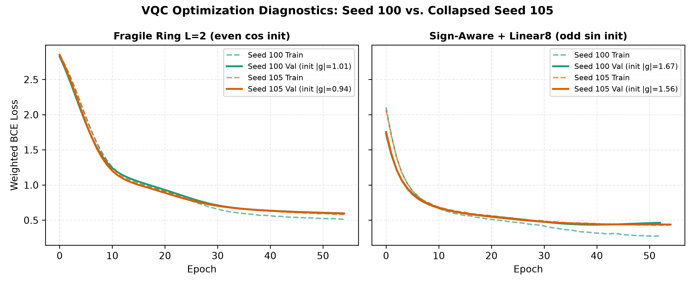
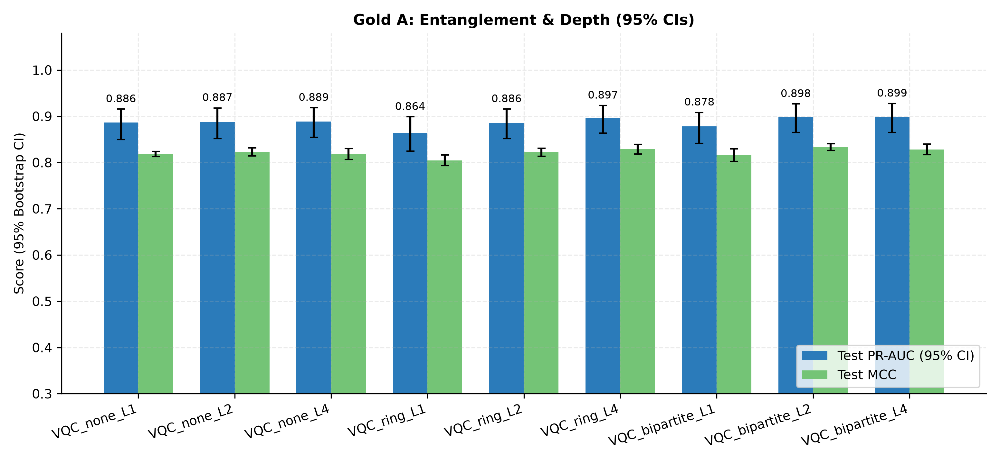
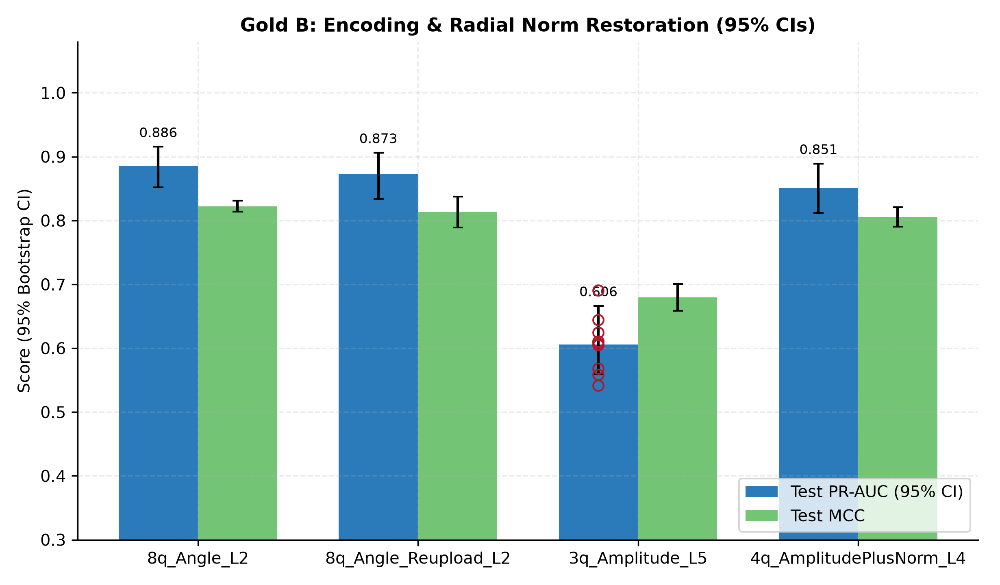

<div align="center">

<samp>Q // HORIZON 2026 &nbsp;·&nbsp; KUBITS TEAM: Zeyad Mohamed Nada, Omar Eslam, Youssef Sallam</samp>

# Pulsar Signal Classification<br><sub>Variational Circuits & Quantum Kernels vs. Classical Baselines</sub>

<p>
  <a href="https://zeyadmsn07.github.io/qhorizon-2026/"><kbd>&nbsp;Interactive Landing Page ↗&nbsp;</kbd></a>
  &nbsp;&nbsp;
  <a href="docs/QHorizon_Pulsar_Classification_Report_Kubits.pdf"><kbd>&nbsp;Final 4-Page Report (PDF)&nbsp;</kbd></a>
  &nbsp;&nbsp;
  <a href="Q_Horizon_Benchmark.ipynb"><kbd>&nbsp;Benchmark Notebook&nbsp;</kbd></a>
  &nbsp;&nbsp;
  <a href="results/full/summary_tables.md"><kbd>&nbsp;Full 10-Seed Tables&nbsp;</kbd></a>
  &nbsp;&nbsp;
  <a href="AI_USAGE_LOG.md"><kbd>&nbsp;AI Usage Log&nbsp;</kbd></a>
</p>

<sub><b>Dataset:</b> UCI HTRU2 (17,898 candidates, 9.16% pulsars) &nbsp;&middot;&nbsp; <b>Circuit Size:</b> Up to 8 qubits &nbsp;&middot;&nbsp; <b>Protocol:</b> 3 tune seeds / 10 test seeds &nbsp;&middot;&nbsp; <b>Stack:</b> PennyLane, PyTorch, scikit-learn</sub>

</div>

---

## Why Radio Pulsars on Eight Qubits

We benchmark compact quantum classifiers on the **UCI HTRU2 Pulsar Candidate Dataset** (R. J. Lyon et al., 2016, ID `372`), containing 17,898 radio-telescope detections described by 8 continuous statistics: four from the folded pulse profile and four from the dispersion-measure signal-to-noise (DM-SNR) curve. We chose it for three reasons:

1. Its 8 physical features map one-to-one onto 8 qubits ($\le 10$-qubit ceiling) without PCA, letting us wire the 4 pulse-profile qubits directly to the 4 DM-SNR qubits.
2. Only 9.16% of candidates are real pulsars, so predicting noise every time scores 90.84% accuracy while catching zero pulsars; we therefore evaluate with Precision-Recall AUC (PR-AUC) and Matthews Correlation Coefficient (MCC).
3. Clean tabular physics summaries favor classical baselines, making HTRU2 an honest test rather than a cherry-picked task; to isolate nonlinear geometry, we pair it with a synthetic 8D inner-ball benchmark (`ConcentricShell-8D`).

---

## Explore & Run the Project

To make our results intuitive and easy to explore without digging through raw CSVs, we built an interactive landing page to switch datasets, inspect 10-seed confidence intervals, and walk through every experiment visually.

<table>
<tr>
<td width="50%" valign="top">

### <samp>01 // ONLINE</samp><br>Browser & Google Colab

Explore the hosted dashboard in any browser:

<p align="center">
  <a href="https://zeyadmsn07.github.io/qhorizon-2026/"><b>https://zeyadmsn07.github.io/qhorizon-2026/</b></a>
</p>

To run in the cloud, open `Q_Horizon_Benchmark.ipynb` in Google Colab, run `pip install -r requirements.txt`, and execute all cells.

</td>
<td width="50%" valign="top">

### <samp>02 // OFFLINE</samp><br>Local HTML & CLI Suite

HTRU2 is cached in `data_cache/htru2.csv` for full offline runs.

Double-click `dashboard/qhorizon_dashboard.html` to view the dashboard locally (or run `python dashboard/serve.py`), or reproduce runs from the terminal below.

</td>
</tr>
</table>

To reproduce the results from the terminal (the times are approximate):

```bash
pip install -r requirements.txt
python scripts/check_submission.py            # Run all 14 unit & submission checks (~5 sec)
python run_all.py --mode smoke                # Quick pipeline check (~7.5 min -> results/smoke/)
python run_all.py --mode fast                 # Medium 3-seed pass (~12.5 min -> results/fast/)
python run_all.py --mode full --tune-seeds 3  # Full 10-seed sweep (-> results/full/)
```

---

## 1. Main Benchmark & Key Findings ($N = 500$)

Here, `Q1-VQC` is our variational quantum classifier and `Q2-QuantumKernel` is a quantum-kernel SVM. All models are compared under the same protocol:

> [!IMPORTANT]
> Every tunable model searches 20 configurations across 3 disjoint validation seeds (`200..202`) before evaluation on 10 test seeds (`100..109`). Yeo-Johnson transforms are fit on `X_train` only, thresholds are chosen on `y_val` only, `Q1-VQC` and `Tiny-MLP` both train 41 weights with AdamW, and `Q2-QuantumKernel` and `RBF-SVM` share the exact same dual SVM solver.

Key findings:

- Classical models lead on HTRU2 (`Tiny-MLP` `0.9246`, `RBF-SVM` `0.9227`) ahead of `Q2-QuantumKernel` (`0.9116`) and `Q1-VQC` (`0.9102`); only `Q2-QuantumKernel` beats `RandomForest` (`0.9016`) beyond our $\pm 0.01$ margin (`+0.0101`), while `Q1-VQC` (`+0.0086`) sits inside the tie band.
- Disjoint 3-seed tuning eliminated the 2/10 seed collapses seen in our `v1` `Ring L=2` baseline (`0.8860`, `0/10` collapses), and combining sparse bipartite wiring (8 CNOTs vs. 16) with a $\pi/2$ sign shift and 8-qubit linear readout lifted `Q1-VQC` to `0.9102`.
- On `ConcentricShell-8D` ($N = 500$), linear `LogReg` fails (`0.1165`), `Q2-QuantumKernel` (`0.8832`) and `RBF-SVM` (`0.8695`) statistically tie, and 41-weight `Q1-VQC` (`0.6602`) tops 4-neuron `Tiny-MLP` (`0.4075`) due to $\cos(\cdot)$-aligned even symmetry and a 4-neuron width bottleneck (`32` neurons reach `0.7767`).

The chart and table below summarize HTRU2 performance at $N = 500$ over the 10 test seeds:

<p align="center">
  
</p>

| Model | PR-AUC (Mean $\pm$ Std) | Collapse | Test F1 | Test MCC | Weights | SVs | CPU s\* |
| :--- | :---: | :---: | :---: | :---: | :---: | :---: | :---: |
| Dummy | $0.0917 \pm 0.0000$ | 10/10 | $0.0000$ | $0.0000$ | 0 | -- | 0.00 |
| LogReg | $0.9184 \pm 0.0169$ | 0/10 | $0.8737$ | $0.8619$ | 9 | -- | 0.01 |
| RBF-SVM | $0.9227 \pm 0.0036$ | 0/10 | $0.8702$ | $0.8579$ | 0 | 64.9 | 0.01 |
| RandomForest | $0.9016 \pm 0.0089$ | 0/10 | $0.8494$ | $0.8358$ | 0 | -- | 0.04 |
| **Tiny-MLP (41p)** | **$0.9246 \pm 0.0079$** | **0/10** | **$0.8753$** | **$0.8632$** | **41** | **--** | **0.32** |
| Q1-VQC (Bipartite_SignLinear_41p) | $0.9102 \pm 0.0025$ | 0/10 | $0.8524$ | $0.8384$ | 41 | -- | 11.36 |
| Q1-VQC (Ring L=2, Fragile v1) | $0.8860 \pm 0.0062$ | 0/10 | $0.8373$ | $0.8223$ | 34 | -- | 17.97 |
| Q2-QuantumKernel (8q) | $0.9116 \pm 0.0057$ | 0/10 | $0.8508$ | $0.8360$ | 0 | 55.1 | 0.27 |

<sub>Collapse = number of seeds (out of 10) where the model degenerated to a constant prediction; Weights = trainable parameters; SVs = mean support vectors. *Quantum CPU times reflect <code>default.qubit</code> statevector simulation. Full tables, medians/IQRs, and MLP width checks are in <a href="results/full/summary_tables.md"><code>results/full/summary_tables.md</code></a>.</sub>

---

## 2. Statistical Audit (Mechanical Verdict Ledger)

Hypotheses are graded automatically by `analyze_results.py` using a **Mechanical Verdict** rule ($\pm 0.01$ PR-AUC practical margin and 95% two-level bootstrap CIs across the 10 seeds and 3,000 stratified test samples). In the table, $\Delta$ PR-AUC is Model A minus Model B, and "(tied)" marks hypotheses that predicted no difference:

| ID | Comparison (Model A vs. Model B) | $\Delta$ PR-AUC | 95% Two-Level CI | Wilcoxon $p$ | Verdict |
| :--- | :--- | :---: | :---: | :---: | :---: |
| `H1a` | Tiny-MLP (41p) vs. Q2-QuantumKernel (8q) | `+0.0130` | `[+0.0047, +0.0217]` | 0.0039 | <samp>Supported</samp> |
| `H1b` | Tiny-MLP (41p) vs. Q1-VQC (Bipartite_SignLinear_41p) | `+0.0144` | `[+0.0060, +0.0232]` | 0.0020 | <samp>Supported</samp> |
| `H1c` | Q2-QuantumKernel (8q) vs. RandomForest | `+0.0101` | `[+0.0027, +0.0189]` | 0.0020 | <samp>Supported</samp> |
| `H2a` | VQC_bipartite_L2 vs. VQC_none_L2 | `+0.0110` | `[-0.0006, +0.0227]` | 0.0371 | <samp>Inconclusive</samp> |
| `H2b` | VQC_bipartite_L2 vs. VQC_ring_L2 | `+0.0120` | `[+0.0025, +0.0225]` | 0.0020 | <samp>Supported</samp> |
| `H3` | 4q_AmplitudePlusNorm_L4 vs. 3q_Amplitude_L5 | `+0.2450` | `[+0.1909, +0.2885]` | 0.0020 | <samp>Supported</samp> |
| `H4a` | N=100 Q2-QuantumKernel vs. RBF-SVM (tied) | `-0.0460` | `[-0.0847, -0.0142]` | 0.0098 | <samp>Contradicted</samp> |
| `H4b_2000` | Shots=2000 vs. Analytic (tied) | `-0.0007` | `[-0.0015, +0.0000]` | 0.0059 | <samp>Practically tied</samp> |
| `H4b_500` | Shots=500 vs. Analytic (tied) | `-0.0011` | `[-0.0028, +0.0005]` | 0.1602 | <samp>Practically tied</samp> |
| `H4b_100` | Shots=100 vs. Analytic (tied) | `-0.0068` | `[-0.0112, -0.0031]` | 0.0020 | <samp>Inconclusive</samp> |

The circuit variants named above (`VQC_*`, `4q_*`, `3q_*`) are studied in Section 3.

---

## 3. Circuit Studies: Topology, Encoding & Shot Noise

### <samp>A //</samp> Entanglement Wiring, Readout & Stability

Under 3-seed validation tuning, neither a $\pi/2$ sign shift (`0.8854`) nor an 8-wire linear readout (`0.8869`) improved `Ring L=2` (`0.8860`) alone (`docs/vqc_stability.md`). Switching to bipartite wiring added `+0.0120` (`0.8981`), and combining bipartite wiring + $\pi/2$ shift + 8-wire linear readout reached `0.9102` with half the CNOT gates (8 vs. 16; depth 7 vs. 21). The plots below show the training-loss behavior, the entanglement and depth comparison, and the stability ablation:

| VQC Loss Curves (Seed 100 vs. Seed 105) | Entanglement & Depth (Gold A) |
| :---: | :---: |
|  |  |

<p align="center">
  
</p>

### <samp>B //</samp> Encoding, Sample Sweep & Finite Shots

3-qubit amplitude normalization erases signal strength (`0.6057`), whereas restoring the L2 norm on a 4th wire recovers `+0.2450` PR-AUC (`0.8507`). Standalone classical baselines lead across $N \in \{100, 200, 500, 1000\}$ (though a 20%--30% VQC + MLP blend nudges $N = 100$ to `0.9132`, `+0.0091` inside the tie band), and `Q1-VQC` stays practically tied with analytic readout down to `500` shots (`0.9091`). The plots below cover encoding, training-set size, finite-shot noise, and a linearity check on the full training pool (discussed in Section 4):

| Feature Encoding & Norm (Gold B) | Sample Efficiency Sweep (Gold C) |
| :---: | :---: |
|  |  |

| Finite Shot Noise (Table D) | Full-Pool Linearity Ceiling |
| :---: | :---: |
|  |  |

---

## 4. Deep Diagnostics: Geometry, Width & Hardware Cost

These diagnostics examine why the quantum models behave as they do and what they would cost on real hardware:

- On the full 13,398-sample pool, 9-weight `LogReg` (`0.9377`), `Tiny-MLP` (`0.9394`), `Poly2-LogReg` (`0.9411`), and `RBF-SVM` (`0.9309`) cluster within `~0.01` PR-AUC, while the ZZ kernel peaks at $\alpha = 0.1$ (effective rank `1.84`, `0.9913` RBF correlation) before concentrating at larger $\alpha$ (`0.008` at $\alpha = 2.5$).
- On `ConcentricShell-8D` (an even-symmetry 4D inner ball in 8D), `Q2-QuantumKernel` (`0.8832`) and `RBF-SVM` (`0.8695`) tie at $N = 500$, while `Q1-VQC` climbs from `0.1307` ($N = 100$) to `0.6602` ($N = 500$) vs. `0.4075` for 4-unit `Tiny-MLP` (`8 / 16 / 32` units reach `0.5936 / 0.6195 / 0.7767`).
- On physical QPU hardware (`qml.specs`), `Q1-VQC` scales as $O(N)$ (`500` circuits/epoch; `3,000` test circuits), whereas `Q2-QuantumKernel` requires $O(N^2)$ overlap pairs (`124,750` train + `1,500,000` test pairs at $N = 500$).

The figures below show the kernel analysis and the `ConcentricShell-8D` results:

| Quantum Kernel Spectrum & Concentration | ConcentricShell-8D Generalization |
| :---: | :---: |
|  |  |

---

## 5. Limitations

- All circuits use $\le 8$ qubits ($2^8 = 256$ amplitudes) and simulate quickly on a laptop CPU, so no quantum advantage is claimed in runtime or complexity.
- HTRU2 is ~94% linearly separable, and `Q2-QuantumKernel` peaks at the small $`\alpha`$ boundary ($`\alpha \le 0.1`$) where it mimics a low-rank classical kernel.
- `ConcentricShell-8D` is synthetic with even symmetry, $`f(-x) = f(x)`$, tailored to $`\cos(\cdot)`$ rotations, and fixing `Tiny-MLP` to 4 hidden units bottlenecks radial closure (`h=32` reaches `0.7767`).
- Shot-noise runs (`100`--`2,000` shots) capture multinomial measurement sampling only, not gate errors or decoherence ($T_1/T_2$).

---

## Credits and References

- **Dataset:** UCI HTRU2 Pulsar Candidate Dataset (ID `372`), R. J. Lyon et al. (2016), *MNRAS* 459(1), 1104--1123 (`DOI: 10.24432/C5DK6R`, CC BY 4.0; [`DATA_LICENSE.md`](DATA_LICENSE.md)).
- **Stack & AI Log:** **PennyLane** (`default.qubit`), **PyTorch**, and **scikit-learn**. AI assistance and human verification are logged in [`AI_USAGE_LOG.md`](AI_USAGE_LOG.md).
- **Team:** **Kubits Team** — Zeyad Mohamed Nada, Omar Eslam, and Youssef Sallam ([`docs/TEAM.md`](docs/TEAM.md)).
