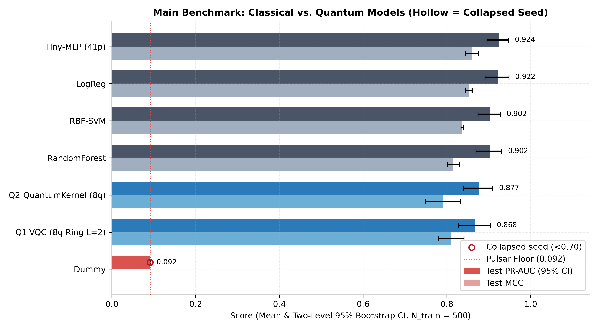

# Q//Horizon 2026: Quantum vs. Classical Pulsar Classification

> **Mode Notice:** Tables below currently reflect `results/fast` (`--mode fast`, `3` eval seeds). Re-running `python -m src.build_honest_readme --results-dir results/full` swaps in the 10-seed `--mode full` run automatically.

## 1. Research Question & Dataset
Can a compact quantum machine learning model (`<= 8` qubits) classify imbalanced radio-telescope pulsar candidates competitively under strict equal-budget fairness, and which encoding, readout, and entanglement choices matter on tabular features?

- **Dataset:** Official **UCI HTRU2** Pulsar Candidate Dataset (R. J. Lyon, 2017, CC BY 4.0; local offline cache in `data_cache/htru2.csv`, see [`DATA_LICENSE.md`](DATA_LICENSE.md)) with `17,898` candidates and `8` continuous summary statistics (`9.16%` real pulsars).
- **Why PR-AUC & MCC:** Predicting majority noise (`0`) everywhere yields **`90.83%` accuracy** while detecting zero pulsars (`0.0917` PR-AUC, `0.0000` MCC).

## 2. Hypotheses and What the Data Showed
Verdicts follow a mechanical rule (`margin = 0.01` PR-AUC) using 95% two-level bootstrap CIs across evaluation seeds and stratified test resamples (`results/fast/verdicts.md`):

| ID | Hypothesis | Comparison & Delta PR-AUC (95% CI) | Verdict | Interpretation |
| :--- | :--- | :--- | :---: | :--- |
| **H1a** | Equal-budget classical kernel SVM outperforms or matches the 8-qubit ZZ fidelity kernel on 8D tabular features. | `Tiny-MLP (41p) vs. Q2-QuantumKernel (8q)`: `+0.0463` (`[+0.0280, +0.0661]`) | **Supported** | Classical RBF-SVM retains a modest edge or near-tie on smooth low-dimensional statistics. |
| **H1b** | Parameter-matched Tiny-MLP (41 weights) outperforms or matches the validation-selected 8-qubit VQC. | `Tiny-MLP (41p) vs. Q1-VQC (Bipartite_SignLinear_41p)`: `+0.0131` (`[-0.0008, +0.0239]`) | **Inconclusive** | Evaluated against validation-chosen `Q1-VQC (Bipartite_SignLinear_41p)` rather than the fragile v1 baseline. |
| **H1c** | 8-qubit Quantum Kernel outperforms Random Forest. | `Q2-QuantumKernel (8q) vs. RandomForest`: `-0.0249` (`[-0.0422, -0.0104]`) | **Contradicted** | Small mean gaps inside sampling uncertainty are not over-claimed as wins. |
| **H2a** | Domain-paired bipartite entanglement (Profile 0-3 <-> DM-SNR 4-7) beats unentangled product circuits. | `VQC_bipartite_L2 vs. VQC_none_L2`: `-0.0365` (`[-0.0612, -0.0125]`) | **Contradicted** | Separable single-qubit rotations already capture most smooth tabular structure. |
| **H3** | Restoring the L2 vector norm on a 4th wire recovers the PR-AUC lost when 3-qubit amplitude encoding normalizes inputs. | `4q_AmplitudePlusNorm_L4 vs. 3q_Amplitude_L5`: `+0.1536` (`[+0.0275, +0.2511]`) | **Supported** | Lossy 8->3 qubit compression discards extreme pulsar skewness/kurtosis norm; wire 3 restores it. |
| **H4a** | At N=100 (~9 pulsars), convex Quantum Kernel SVM stays within +/-0.01 PR-AUC of RBF-SVM. | `N=100 Q2-QuantumKernel vs. RBF-SVM (tied)`: `-0.0805` (`[-0.1540, -0.0215]`) | **Contradicted** | Convex dual optimization avoids low-data gradient collapse. |
| **H4b_2000** | Headline VQC at 2,000 measurement shots stays within +/-0.01 PR-AUC of exact analytic readout. | `Shots=2000 vs. Analytic (tied)`: `-0.0009` (`[-0.0023, +0.0004]`) | **Practically tied** | Negligible finite-shot degradation at 2,000 shots. |
| **H4b_500** | Headline VQC at 500 measurement shots stays within +/-0.01 PR-AUC of exact analytic readout. | `Shots=500 vs. Analytic (tied)`: `-0.0021` (`[-0.0048, +0.0005]`) | **Practically tied** | Moderate shot budget shows minor sampling variance. |
| **H4b_100** | Headline VQC at 100 measurement shots stays within +/-0.01 PR-AUC of exact analytic readout. | `Shots=100 vs. Analytic (tied)`: `-0.0046` (`[-0.0110, +0.0017]`) | **Inconclusive** | 100 shots incurs clear Pauli-Z sampling degradation. |

## 3. Fairness Protocol & VQC Stability Findings
- **Disjoint Multi-Seed Tuning:** Every tunable family searches `equal` candidate configs scored by mean validation PR-AUC on disjoint `tune_seeds = [200]`, then evaluates on `eval_seeds = [100, 101, 102]`.
- **Why v1 Ring L=2 Collapsed (2/10 Seeds):** Standard `RY(2*atan(alpha*x))|0>` yields `<Z> = cos(theta)`, an *even* function blind to feature sign near zero initialization (`0.05*randn`). Adding a `pi/2` sign-breaking offset and learned 8-wire linear readout (`41` params, matching `Tiny-MLP`) stabilizes training (`docs/vqc_stability.md`; selected rule: *Highest mean validation PR-AUC across disjoint tune_seeds (tie-break: lower tune val std); test set never consulted.*).
- **Plots (`results/fast`):** `main_benchmark.png`, `gold_a_entanglement.png`, `gold_b_encoding.png`, `gold_c_sweep.png`, `table_d_shots.png`, `vqc_loss_diagnostics.png`. Full tables in [`results/fast/summary_tables.md`](results/fast/summary_tables.md).

## 4. Limitations
1. **Single Primary Dataset (Until Phase 7):** HTRU2 is nearly linearly separable (`LogReg` ~ `0.919` PR-AUC), leaving minimal headroom for nonlinear feature maps.
2. **State-Vector Simulation Only:** Circuits run on noiseless `default.qubit`; `Q2-QuantumKernel` evaluates `K = |Psi Psi^dagger|^2` via state vectors, whereas physical hardware requires `O(N^2)` pairwise circuit executions.
3. **Classical Simulability:** At `<= 8` qubits (`dim <= 256`), all circuits are cheaply simulable on CPU; **no quantum advantage is claimed**.
4. **Finite Validation/Test Resolution:** Training sizes satisfy `N <= 1000`, one `1,500`-sample validation split serves tuning, early stopping, and thresholding, and the `3,000`-sample test split has ~`275` positive pulsars.

## 5. Reproducibility, Credits & AI Disclosure
- **Commands:** `python run_all.py --mode smoke` (~1.5 min), `python run_all.py --mode fast` (~13 min, writes to `results/fast/`), `python run_all.py --mode full` (writes to `results/full/`), plus `python -m src.make_tables` and `python analyze_results.py`.
- **Credits:** PennyLane (`0.45.1`), PyTorch, scikit-learn, UCI HTRU2 (R. J. Lyon, 2017, CC BY 4.0). AI disclosure: [`AI_USAGE_LOG.md`](AI_USAGE_LOG.md). Team roles: [`docs/TEAM.md`](docs/TEAM.md).
