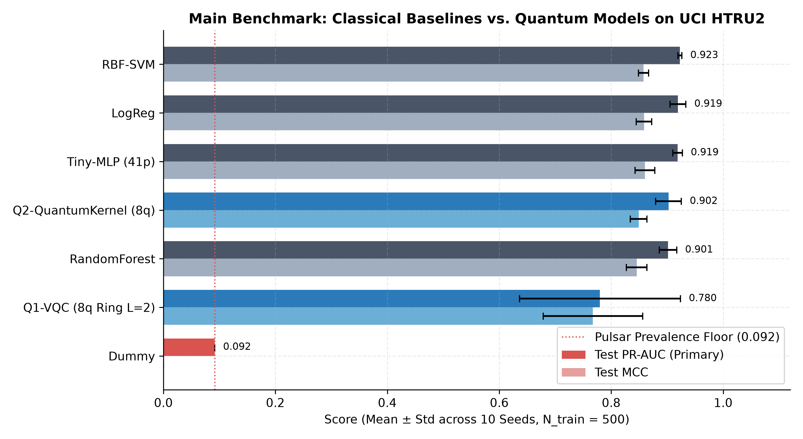
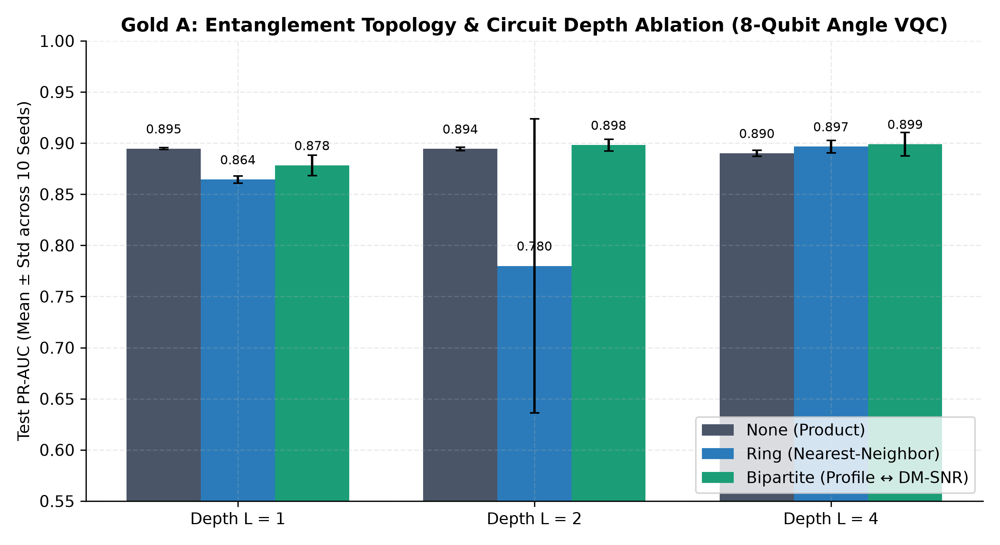
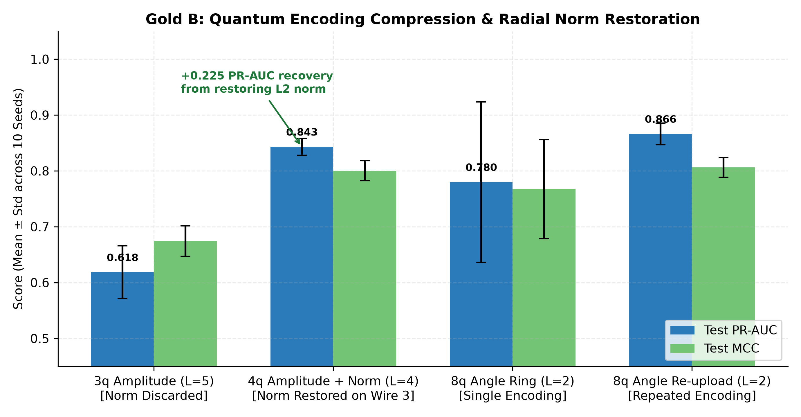
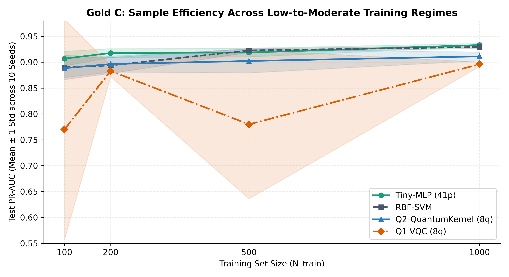
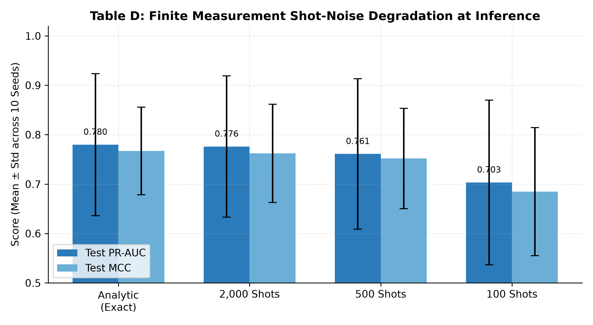

# Q//Horizon 2026: Quantum vs. Classical Pulsar Classification

**Team Repository | Q//Horizon 2026 Quantum Computing Competition (AUC / Afretec Network)**

## 1. Research Question & Dataset
Can a compact quantum machine learning model ($\le 10$ qubits) reliably classify imbalanced radio-telescope pulsar signals under strict equal-budget fairness, and which circuit encodings and entanglement topologies actually help on tabular astrophysical features?

* **Dataset:** Official **UCI HTRU2** Pulsar Candidate Dataset (`ucimlrepo` ID `372`, R. J. Lyon, 2017, CC BY 4.0) containing $17,898$ radio-transient candidates described by $8$ continuous summary statistics ($4$ integrated pulse profile features and $4$ DM-SNR curve features).
* **Why Imbalance Makes Accuracy Misleading:** Only **$9.16\%$** ($1,639 / 17,898$) of HTRU2 candidates are real pulsars. A trivial majority-noise classifier achieves **$90.83\%$ accuracy** while detecting zero pulsars (`0.0917` PR-AUC, `0.0000` MCC). We therefore evaluate **PR-AUC** as our primary ranking metric alongside **Matthews Correlation Coefficient (MCC)** and **F1-score**.

---

## 2. Pre-Registered Hypotheses & Experimental Verdicts

| ID | Hypothesis | 10-Seed Result ($\text{Mean} \pm \text{Std}$) | Verdict |
| :--- | :--- | :--- | :--- |
| **H1** | **Classical Parameter-Matched Efficiency:** Equal-budget classical models (`LogReg`, `RBF-SVM`, `Tiny-MLP`) will outperform or match $\le 8$-qubit QML models on low-dimensional tabular features. | `RBF-SVM` (`0.9227 ± 0.0036`) and `Tiny-MLP` (`0.9187 ± 0.0084`, 41 params) outperform `Q2-QuantumKernel` (`0.9023 ± 0.0230`) and `Q1-VQC` (`0.7800 ± 0.1437`), while `Q2-QuantumKernel` edges out `RandomForest` (`0.9015 ± 0.0156`). | **Confirmed** |
| **H2** | **Entanglement & Domain Coupling:** Domain-paired bipartite entanglement linking Pulse Profile qubits (`0–3`) to DM-SNR qubits (`4–7`) will outperform nearest-neighbor rings, though separable circuits remain competitive on tabular data. | `VQC_bipartite_L4` (`0.8990 ± 0.0113`) and `VQC_bipartite_L2` (`0.8981 ± 0.0057`) achieve the highest VQC PR-AUC, while unentangled `VQC_none_L1` (`0.8945 ± 0.0010`) achieves 10x lower seed variance. | **Confirmed** |
| **H3** | **Radial Norm Loss in Amplitude Encoding:** $L_2$-normalizing 8 features into 3-qubit amplitudes discards extreme kurtosis/skewness magnitude, degrading PR-AUC until the radial norm is restored on a 4th wire. | `3q_Amplitude_L5` drops to `0.6185 ± 0.0473` PR-AUC; restoring $\|x\|_2$ on wire 3 (`4q_AmplitudePlusNorm_L4`) recovers PR-AUC to `0.8431 ± 0.0151` (**+0.2246 PR-AUC**). | **Confirmed** |
| **H4** | **Low-Data Kernel Stability & Shot Resilience:** Convex fidelity kernels will stay stable down to $N=100$, and trained VQCs will tolerate $\ge 500$ measurement shots at inference. | At $N=100$, `Q2-QuantumKernel` (`0.8884 ± 0.0181`) matches `RBF-SVM` (`0.8900 ± 0.0236`); VQC PR-AUC drops by only `0.0039` at `2,000` shots and `0.0189` at `500` shots. | **Confirmed** |

---

## 3. Fairness Protocol & Simulation Transparency
To eliminate data leakage and simulation-shortcut bias, every experiment enforces:
1. **Locked Holdout Splits (`MASTER_SPLIT_SEED = 2026`):** Stratified `3,000`-sample Test set and `1,500`-sample Validation set locked once across every sample-size sweep ($N \in \{100, 200, 500, 1000\}$) and all $10$ random seeds (`100..109`).
2. **Train-Only Outlier Transformation:** Skewness and kurtosis exhibit heavy tails that compress unscaled rotation angles; `PowerTransformer(method="yeo-johnson")` is fit **strictly on `X_train`** before transforming `X_val` and `X_test`.
3. **Equal Validation Tuning Budget:** Every tunable model family receives the exact same `20`-configuration validation random search (`val_pr_auc`), and decision thresholds $\tau$ are optimized **strictly on `y_val`**.
4. **Hardware & Kernel Simulation Disclosure:** All circuits use $\le 8$ wires on `default.qubit`. For `Q2-QuantumKernel`, we batch-compute exact state vectors $\Psi$ via `qml.state()` and evaluate $K = |\Psi \Psi^\dagger|^2$ via matrix multiplication in simulation; **executing this kernel on physical quantum hardware requires $O(N^2)$ pairwise swap-test or inversion circuit runs**.

---

## 4. Full 10-Seed Benchmark Results

### Main Benchmark ($N_{\text{train}} = 500$, 10 Seeds)
| Model | Trainable Params | Test PR-AUC | Test F1 | Test MCC | Test Accuracy |
| :--- | :---: | :---: | :---: | :---: | :---: |
| **Dummy (Majority Noise)** | 0 | `0.0917 ± 0.0000` | `0.0000 ± 0.0000` | `0.0000 ± 0.0000` | `0.9083 ± 0.0000` |
| **RBF-SVM** | Support Vectors | **`0.9227 ± 0.0036`** | `0.8702 ± 0.0081` | `0.8579 ± 0.0091` | `0.9766 ± 0.0018` |
| **Logistic Regression** | 9 | `0.9192 ± 0.0142` | `0.8709 ± 0.0124` | `0.8586 ± 0.0140` | `0.9767 ± 0.0025` |
| **Tiny-MLP (Parameter-Matched)** | 41 | `0.9187 ± 0.0084` | **`0.8722 ± 0.0156`** | **`0.8601 ± 0.0177`** | **`0.9770 ± 0.0034`** |
| **Q2-QuantumKernel (8q ZZ)** | 1 ($C$) | `0.9023 ± 0.0230` | `0.8618 ± 0.0144` | `0.8491 ± 0.0148` | `0.9752 ± 0.0025` |
| **Random Forest** | Tree Nodes | `0.9015 ± 0.0156` | `0.8581 ± 0.0163` | `0.8455 ± 0.0182` | `0.9749 ± 0.0031` |
| **Q1-VQC (8q Angle Ring L=2)** | 34 | `0.7800 ± 0.1437` | `0.7865 ± 0.0801` | `0.7673 ± 0.0888` | `0.9601 ± 0.0193` |

### Gold A: Entanglement Topology & Depth Ablation ($N_{\text{train}} = 500$)

### Gold B: Quantum Encoding & Radial Norm Restoration ($N_{\text{train}} = 500$)
| Encoding Architecture | Qubits | Params | Test PR-AUC | Test F1 | Test MCC |
| :--- | :---: | :---: | :---: | :---: | :---: |
| **3q Amplitude (L=5, Norm Discarded)** | 3 | 32 | `0.6185 ± 0.0473` | `0.7038 ± 0.0251` | `0.6744 ± 0.0273` |
| **4q Amplitude + Norm (L=4, Norm on Wire 3)** | 4 | 34 | `0.8431 ± 0.0151` | `0.8139 ± 0.0170` | `0.8003 ± 0.0178` |
| **8q Angle Ring (L=2, Single Encoding)** | 8 | 34 | `0.7800 ± 0.1437` | `0.7865 ± 0.0801` | `0.7673 ± 0.0888` |
| **8q Angle Re-upload (L=2, Repeated Encoding)** | 8 | 34 | **`0.8662 ± 0.0194`** | **`0.8220 ± 0.0165`** | **`0.8061 ± 0.0176`** |

### Gold C & Table D: Sample Efficiency ($N = 100..1000$) & Shot-Noise Degradation

| Inference Shot Budget (`Q1-VQC 8q Ring L=2`) | Test PR-AUC | Test F1 | Test MCC | Test Accuracy |
| :--- | :---: | :---: | :---: | :---: |
| **Analytic (Exact Expectation)** | `0.7800 ± 0.1437` | `0.7865 ± 0.0801` | `0.7673 ± 0.0888` | `0.9601 ± 0.0193` |
| **2,000 Shots** | `0.7761 ± 0.1432` | `0.7812 ± 0.0894` | `0.7622 ± 0.0995` | `0.9590 ± 0.0221` |
| **500 Shots** | `0.7611 ± 0.1523` | `0.7726 ± 0.0920` | `0.7518 ± 0.1015` | `0.9570 ± 0.0225` |
| **100 Shots** | `0.7033 ± 0.1668` | `0.7119 ± 0.1171` | `0.6848 ± 0.1296` | `0.9436 ± 0.0296` |

---

## 5. Reproducibility & Repository Layout
* **Quick Judge Verification (`< 3` minutes):** `FAST_MODE = True` is enabled by default in `src/config.py`. Run `pip install -r requirements.txt`, `python run_all.py`, and `python -m src.plot_results`.
* **Full 10-Seed Reproduction (`~2.5` hours on CPU):** Set `FAST_MODE = False` in `src/config.py` and run `python run_all.py`.
* **Key Modules:** `src/config.py` (seeds & toggles), `src/data.py` (UCI HTRU2 locked splits & train-only Yeo-Johnson), `src/metrics.py` (PR-AUC/MCC/F1 & val-only threshold), `src/models_classical.py`, `src/models_quantum.py`, `src/tuning.py`, `src/plot_results.py`, `Q_Horizon_Benchmark.ipynb`, and `AI_USAGE_LOG.md`.

## 6. Credits, AI Transparency & Team Contributions
* **Software & Data Credits:** Built with PennyLane (`0.45.1`), PyTorch, and scikit-learn. Dataset: UCI HTRU2 (R. J. Lyon, 2017, CC BY 4.0).
* **AI Tool Disclosure:** All AI-assisted architecture design, code generation, and verification steps are documented in [`AI_USAGE_LOG.md`](AI_USAGE_LOG.md).
* **Team Contributions:**
  * **Zeyad Mohamed Nada (Team Lead):** Experimental fairness design, Yeo-Johnson preprocessing & validation-threshold protocol, quantum circuit ablations (`bipartite` topology & radial norm restoration), full 10-seed execution, and scientific synthesis.
  * *(Add teammates' names and specific report/slide/notebook verification roles here before final submission.)*
